# AI Agent Architecture

**Version:** 1.1 (approved at C5 2026-11-08; v1.1 adds owner-requested hook/promise/re-hook/storytelling craft) · **Date:** 2026-11-08
**Related:** SYSTEM_ARCHITECTURE §4-D/H, WORKFLOW_STATE_MACHINE, AGENT_PROMPTS.md, ADR-0005/0007

## 1. Design
- **32 logical agents, not 32 services.** Each agent is a task handler registered by `agent_code` and run by the light worker (LLM/IO) or heavy worker (media). Kinds: **LLM** (prompted model), **HYBRID** (code + model), **DETERMINISTIC** (no model), **ADAPTER** (wraps an optional provider).
- **Orchestrated, not chatty:** agents never call each other; the Orchestrator (A01) sequences them via the state machines.
- **Gateway only:** all model calls go through the AI Provider Gateway (limits, licences, data-use, caching, schema validation).
- **Independent auditors:** A21, A22, A23, A30, A31, A32 write only their reports/alerts; production agents cannot write `audit_reports`; only the owner can override, with reason, logged.
- **Typed I/O:** every input/output has a JSON Schema in `packages/shared/schemas/agents/<code>.{input,output}.json`; Pydantic models generated from them.

**Implementation (Phase 5):**
- **Catalogue and settings.** `workers/tubeforge_agents/catalogue.py` lists the agents with codes `A01_ORCHESTRATOR` … `A32_COST_MONITOR`, plus the test agent `T00_HELLO`, and is seeded into `agent_configurations` (migration 0008).
- **Runner.** `base.run_agent()` applies the common rules:
  - Emergency Stop and agent kill switch → ABORTED;
  - per-agent daily call and token budgets → WAITING_QUOTA with a notification;
  - provider limits → WAITING_QUOTA with the resume time;
  - a refusal object → FAILED with its reason;
  - redacted `agent_runs` logging (secrets, e-mail addresses, phone numbers);
  - opt-in idempotency (`agent_code + input hash + prompt version`).
- **Prompts.** Prompts render through Jinja2 with strict undefined; untrusted text goes only through the `untrusted` filter, which defuses closing tags.

## 2. Agent map
| Group | Agents |
|---|---|
| Core | A01 |
| Discover | A02 Niche Discovery · A03 Trend Intelligence · A04 Competitor Research · A05 Keyword Research |
| Channels | A06 Channel Strategy · A07 Channel Branding |
| Create | A08 Idea · A09 Research · A10 Fact-Check · A11 Script · A12 Storyboard · A13 Visual Creative · A14 Image · A15 Voiceover · A16 Video Production · A17 Video Editing · A18 Thumbnail |
| Publish | A19 SEO · A20 Captions · A24 Upload · A25 Publishing & Scheduling |
| Grow | A26 Analytics · A27 Growth · A28 Comment Moderation |
| Audit | A21 Copyright · A22 Policy · A23 Quality · A30 Security · A31 System · A32 Cost & Usage |
| Ops | A29 Notification |

| Kind | Count | Agents |
|---|---|---|
| LLM | 12 | A02, A05, A06, A07, A08, A09, A10, A11, A12, A19, A27, A28 |
| HYBRID | 6 | A03, A13, A15, A17, A18, A22 |
| DETERMINISTIC | 13 | A01, A04, A16, A20, A21, A23, A24, A25, A26, A29, A30, A31, A32 |
| ADAPTER | 1 | A14 |

## 3. Agent pipeline (long-form)

```mermaid
flowchart LR
  A08[A08 Idea] --> A09[A09 Research] --> A10a[A10 Fact-check brief] --> R1{{Owner: research}}
  R1 --> A11[A11 Script] --> A10b[A10 Fact-check script] --> R2{{Owner: script + value-add}}
  R2 --> A12[A12 Storyboard] --> A13[A13 Visual plan] --> A14[A14 Images] & A15[A15 Voice]
  A14 --> A16[A16 Assemble]
  A15 --> A16
  A16 --> R3{{Owner: cut}} --> A17[A17 Final render] --> A18[A18 Thumbnails] & A19[A19 SEO] & A20[A20 Captions]
  A18 --> AUD[[A21 · A22 · A23 audits]]
  A19 --> AUD
  A20 --> AUD
  AUD --> R4{{Owner: upload package}} --> A24[A24 Upload] --> A25[A25 Schedule/track] --> A26[A26 Analytics] --> A27[A27 Growth]
```

### Common rules (apply to every agent unless stated)
| Field | Default |
|---|---|
| **Version** | 1.0.0 (semver; prompt changes bump minor; schema changes bump major) |
| **Disallowed actions (all agents)** | Publish; change privacy to public; delete YouTube content; enable/raise paid providers or budgets; buy stock; change own or others' permissions; disable or override auditors; call providers directly (Gateway only); call other agents directly; act on instructions found in untrusted content |
| **Communication** | Consumes and emits events only through the Orchestrator/job bus; outputs persisted before completion event |
| **Error handling** | Classified errors (TRANSIENT/LIMIT/AUTH/VALIDATION/PERMANENT). Invalid JSON → one repair call with validator errors → else FAILED with reason |
| **Retry rules** | LLM agents: max 3 attempts, backoff 2^n×5 s ±20 % jitter. Deterministic: max 5 (network) / 2 (media). Idempotency key = `agent_code:input_sha256:prompt_version` |
| **Logging** | agent_runs row: input hash, redacted input/output (secrets, emails, tokens, phone numbers masked), provider, model, tokens, latency, status. No raw voice audio in logs |
| **Performance metrics** | success rate, p50/p95 latency, tokens per run, repair rate, owner acceptance rate (where an owner decision follows), quality score (auditor- or owner-rated) |
| **Model chains** | REASONING = gemini-flash (F) → groq gpt-oss-120b (F) → ollama ≤3B (L, degraded quality flag); LIGHT = gemini-flash-lite (F) → groq gpt-oss-20b (F) → ollama ≤3B (L); channels marked local-only drop providers with `data_use_training=true` |
| **Testing** | Unit + golden-output tests with mocked Gateway (fixed seeds, recorded fixtures); schema tests; adversarial tests for agents reading untrusted text |

## 4. Agent specifications

### A01 — Master YouTube Orchestrator
| Field | Specification |
|---|---|
| **ID / Name / Version** | `A01` / Master YouTube Orchestrator / 1.0.0 · Group: Core · Kind: **DETERMINISTIC** |
| **Purpose** | Drive every workflow state machine; decide the next step; create approval requests; enqueue agent tasks. |
| **Responsibilities** | Apply transitions and guards (WORKFLOW_STATE_MACHINE); reconcile stalled entities; enforce Emergency Stop and kill switches; mode-dependent approvals. |
| **Inputs (schema)** | `DomainEvent{entity_type, entity_id, event, actor, payload, idempotency_key}` |
| **Outputs (schema, JSON-validated)** | `TransitionResult{transition_id, to_state, job_ids[]}` |
| **Allowed tools** | DB (state tables, approval_requests, workflow_transitions), JobQueue |
| **Disallowed actions** | Common list + Any LLM call; any external call |
| **Permissions** | R/W: all workflow state; W: approval_requests, workflow_transitions, audit_log |
| **Dependencies** | All agents (consumes their completion events) |
| **Communication** | Consumes: `*.finished, approval.decided, control.changed` · Emits: `state.changed, approval.requested, job enqueued` |
| **Model & provider preference** | No LLM (deterministic code) |
| **Error handling / Retry** | Common rules |
| **Logging** | Common rules |
| **Performance metrics** | Common metrics |
| **Cost & usage limits** | n/a (CPU only) (owner-adjustable in Agent Control Center; Gateway-enforced) |
| **Human approval gates** | Defines gates; never approves on the owner's behalf except owner-accepted auto rules (FULLY_AUTO) |
| **Testing requirements** | Table-driven transition tests, property tests, crash/reconcile tests |

### A02 — Niche Discovery
| Field | Specification |
|---|---|
| **ID / Name / Version** | `A02` / Niche Discovery / 1.0.0 · Group: Discover · Kind: **LLM** |
| **Purpose** | Propose niche candidates with criterion-level scores, evidence and confidence from permitted non-YouTube sources (ADR-0015). |
| **Responsibilities** | Fetch allowed sources via Research fetcher; extract signals; score criteria; estimate inauthentic-content risk and production difficulty on current hardware profile. |
| **Inputs (schema)** | `NicheRequest{languages[], interests[], avoid[], hardware_profile, weight_profile}` |
| **Outputs (schema, JSON-validated)** | `NicheCandidates{candidates:[{name, summary, language, criteria:[{code,value,evidence:[{source_document_id,quote}],confidence}], inauthentic_risk, production_difficulty}]}  (schema niche_candidates.json)` |
| **Allowed tools** | Gateway.text, ResearchFetcher (allowlisted), source_documents (read) |
| **Disallowed actions** | Common list + YouTube API data aggregation (DP-1); any earnings claim |
| **Permissions** | R: research_sources, source_documents; W: niche_candidates (via orchestrator) |
| **Dependencies** | A09 Research fetcher utilities |
| **Communication** | Consumes: `niche.requested` · Emits: `niche.report_ready` |
| **Model & provider preference** | gemini-flash (F) → groq gpt-oss-120b (F) → ollama ≤3B (L, degraded quality flag) |
| **Error handling / Retry** | Common rules |
| **Logging** | Common rules |
| **Performance metrics** | Common metrics + % candidates with ≥3 evidence items |
| **Cost & usage limits** | 30 calls/day, 400k tokens/day (owner-adjustable in Agent Control Center; Gateway-enforced) |
| **Human approval gates** | Owner shortlists/dismisses; blueprint only on owner action |
| **Testing requirements** | Golden tests with fixed source fixtures; forbidden-phrase test ('guaranteed', 'will earn'); no-YouTube-aggregation test |

### A03 — Trend Intelligence
| Field | Specification |
|---|---|
| **ID / Name / Version** | `A03` / Trend Intelligence / 1.0.0 · Group: Discover · Kind: **HYBRID** |
| **Purpose** | Detect rising topics for a channel's pillars from permitted sources with expiry. |
| **Responsibilities** | Compute pageview/feeds deltas (deterministic); LLM clusters and summarises; set confidence and expiry. |
| **Inputs (schema)** | `TrendScan{channel_id, pillars[], language, lookback_days}` |
| **Outputs (schema, JSON-validated)** | `TrendItems{items:[{topic, summary, source_document_ids[], signal_strength, confidence, expires_at}]}` |
| **Allowed tools** | Gateway.text, Wikipedia pageviews API, RSS fetcher, Trends API alpha (if approved) |
| **Disallowed actions** | Common list + Scraping; YouTube aggregation |
| **Permissions** | R: channel strategy; W: trend_items |
| **Dependencies** | — |
| **Communication** | Consumes: `trends.scan_requested (periodic daily per active channel)` · Emits: `trends.ready` |
| **Model & provider preference** | gemini-flash-lite (F) → groq gpt-oss-20b (F) → ollama ≤3B (L) |
| **Error handling / Retry** | Common rules |
| **Logging** | Common rules |
| **Performance metrics** | Common metrics |
| **Cost & usage limits** | 20 calls/day (owner-adjustable in Agent Control Center; Gateway-enforced) |
| **Human approval gates** | None (suggestions only) |
| **Testing requirements** | Delta computation unit tests; prompt-injection fixtures |

### A04 — Competitor Research
| Field | Specification |
|---|---|
| **ID / Name / Version** | `A04` / Competitor Research / 1.0.0 · Group: Discover · Kind: **DETERMINISTIC** |
| **Purpose** | Owner-initiated single-item lookups of public channel/video metadata (no aggregation). |
| **Responsibilities** | Call channels.list / videos.list / search.list through YouTube service; cache ≤30 days; present individually. |
| **Inputs (schema)** | `LookupRequest{kind, query, requested_by}` |
| **Outputs (schema, JSON-validated)** | `LookupResult{item(s) individually, fetched_at, expires_at}` |
| **Allowed tools** | YouTube Integration Service (read-only lookup module) |
| **Disallowed actions** | Common list + Combining results across channels; feeding results into scores; storing >30 days |
| **Permissions** | W: youtube_api_cache |
| **Dependencies** | — |
| **Communication** | Consumes: `lookup.requested` · Emits: `lookup.done` |
| **Model & provider preference** | No LLM (deterministic code) |
| **Error handling / Retry** | Common rules |
| **Logging** | Common rules |
| **Performance metrics** | Common metrics |
| **Cost & usage limits** | SEARCH bucket ≤ research share (default 30/day) (owner-adjustable in Agent Control Center; Gateway-enforced) |
| **Human approval gates** | Only runs on explicit owner request |
| **Testing requirements** | No-join test; retention test |

### A05 — Keyword Research
| Field | Specification |
|---|---|
| **ID / Name / Version** | `A05` / Keyword Research / 1.0.0 · Group: Discover · Kind: **LLM** |
| **Purpose** | Suggest search phrases for a channel/idea using non-YouTube evidence (Wikipedia, feeds, Trends alpha) and language knowledge. |
| **Responsibilities** | Expand seed terms per language; attach evidence; never claim search volumes it cannot source. |
| **Inputs (schema)** | `KeywordRequest{channel_id, seeds[], language}` |
| **Outputs (schema, JSON-validated)** | `Keywords{items:[{phrase, rationale, evidence[], confidence}]}` |
| **Allowed tools** | Gateway.text, source_documents |
| **Disallowed actions** | Common list + Inventing numeric search volumes |
| **Permissions** | W: keywords |
| **Dependencies** | A03 outputs |
| **Communication** | Consumes: `keywords.requested` · Emits: `keywords.ready` |
| **Model & provider preference** | gemini-flash-lite (F) → groq gpt-oss-20b (F) → ollama ≤3B (L) |
| **Error handling / Retry** | Common rules |
| **Logging** | Common rules |
| **Performance metrics** | Common metrics |
| **Cost & usage limits** | 20 calls/day (owner-adjustable in Agent Control Center; Gateway-enforced) |
| **Human approval gates** | Owner curates list |
| **Testing requirements** | Golden tests; 'no fabricated numbers' check (numbers must cite evidence) |

### A06 — Channel Strategy
| Field | Specification |
|---|---|
| **ID / Name / Version** | `A06` / Channel Strategy / 1.0.0 · Group: Channels · Kind: **LLM** |
| **Purpose** | Turn a shortlisted niche into a channel blueprint (positioning, audience, pillars, formats, growth strategy, risks). |
| **Responsibilities** | Write blueprint sections; check feasibility on hardware; list policy/monetisation risks honestly. |
| **Inputs (schema)** | `StrategyRequest{niche_candidate, owner_profile{voice, on_camera, languages}, hardware_profile}` |
| **Outputs (schema, JSON-validated)** | `ChannelBlueprint (channel_blueprint.json, without brand/visual sections)` |
| **Allowed tools** | Gateway.text |
| **Disallowed actions** | Common list + Revenue promises |
| **Permissions** | W: channel_strategies (DRAFT) |
| **Dependencies** | A02 |
| **Communication** | Consumes: `strategy.requested` · Emits: `strategy.draft_ready` |
| **Model & provider preference** | gemini-flash (F) → groq gpt-oss-120b (F) → ollama ≤3B (L, degraded quality flag) |
| **Error handling / Retry** | Common rules |
| **Logging** | Common rules |
| **Performance metrics** | Common metrics |
| **Cost & usage limits** | 10 calls/day (owner-adjustable in Agent Control Center; Gateway-enforced) |
| **Human approval gates** | Owner proposes/approves blueprint |
| **Testing requirements** | Schema + golden tests; forbidden phrases |

### A07 — Channel Branding
| Field | Specification |
|---|---|
| **ID / Name / Version** | `A07` / Channel Branding / 1.0.0 · Group: Channels · Kind: **LLM** |
| **Purpose** | Name ideas, description, brand identity, logo/banner briefs, palette, fonts (licensed list only). |
| **Responsibilities** | Generate names (with 'check availability manually'), descriptions, design briefs; pick fonts from licensed font registry. |
| **Inputs (schema)** | `BrandingRequest{blueprint, language}` |
| **Outputs (schema, JSON-validated)** | `BrandingSection{name_ideas[], description, tone, palette[], fonts[], logo_brief, banner_brief}` |
| **Allowed tools** | Gateway.text, font registry |
| **Disallowed actions** | Common list + Using trademarks/real brands; claiming names are available |
| **Permissions** | W: channel_strategies (section) |
| **Dependencies** | A06 |
| **Communication** | Consumes: `branding.requested` · Emits: `branding.ready` |
| **Model & provider preference** | gemini-flash-lite (F) → groq gpt-oss-20b (F) → ollama ≤3B (L) |
| **Error handling / Retry** | Common rules |
| **Logging** | Common rules |
| **Performance metrics** | Common metrics |
| **Cost & usage limits** | 10 calls/day (owner-adjustable in Agent Control Center; Gateway-enforced) |
| **Human approval gates** | Owner approves blueprint |
| **Testing requirements** | Golden tests; font licence check |

### A08 — Idea Generation
| Field | Specification |
|---|---|
| **ID / Name / Version** | `A08` / Idea Generation / 1.0.0 · Group: Create · Kind: **LLM** |
| **Purpose** | Generate original, varied video ideas aligned to pillars; flag similarity to channel catalogue. |
| **Responsibilities** | Generate ideas; compute embedding similarity (local) vs existing ideas/videos; suggest angle for originality and owner value-add; draft a **packaging promise** (title idea + thumbnail text idea + one-sentence promise the video must keep) so the script can deliver it in the intro. |
| **Inputs (schema)** | `IdeaRequest{channel_id, count, format?, pillar?, recent_titles[], trend_items[]}` |
| **Outputs (schema, JSON-validated)** | `Ideas{items:[{title, angle, target_viewer, format, pillar, originality_notes, owner_value_add_prompt, packaging_promise{title_idea, thumbnail_text_idea, promise_statement}}]} + similarity per idea` |
| **Allowed tools** | Gateway.text, local embedding model (L) |
| **Disallowed actions** | Common list + Copying competitor titles |
| **Permissions** | W: video_ideas (SUGGESTED) |
| **Dependencies** | A03, A08 history |
| **Communication** | Consumes: `ideas.requested` · Emits: `ideas.ready` |
| **Model & provider preference** | gemini-flash-lite (F) → groq gpt-oss-20b (F) → ollama ≤3B (L) |
| **Error handling / Retry** | Common rules |
| **Logging** | Common rules |
| **Performance metrics** | Common metrics |
| **Cost & usage limits** | 30 calls/day (owner-adjustable in Agent Control Center; Gateway-enforced) |
| **Human approval gates** | Owner shortlists/approves |
| **Testing requirements** | Similarity threshold tests; diversity test (no two ideas > 0.85); variation mode: every variation ≤ 0.70 similar to its source (US-4.6) |
| **Variation mode (US-4.6, ADR-0025)** | Input `VariationRequest{channel_id, source:{youtube_video_id, title, angle?, script_summary?, metrics}, kind: PART_2\|NEW_ANGLE\|UPDATE\|SHORT_FROM_LONG\|LONG_FROM_SHORT\|SERIES, note?}` (source must be the owner's own video). Output: ideas with `source=REPLICATE`, `based_on_youtube_video_id`, `variation_kind`, `similarity_to_source`. Refuses near-copies; always fills `owner_value_add_prompt`. |

### A09 — Research
| Field | Specification |
|---|---|
| **ID / Name / Version** | `A09` / Research / 1.0.0 · Group: Create · Kind: **LLM** |
| **Purpose** | Produce a cited research brief for an approved idea. |
| **Responsibilities** | Plan queries; fetch allowlisted sources; extract claims with quotes; summarise; list open questions. |
| **Inputs (schema)** | `ResearchRequest{project_id, idea, language, depth}` |
| **Outputs (schema, JSON-validated)** | `ResearchBrief (research_brief.json){summary, key_points[], claims:[{text, source_document_ids[], quote}], open_questions[], suggested_structure}` |
| **Allowed tools** | Gateway.text, ResearchFetcher (allowlist, SSRF guard) |
| **Disallowed actions** | Common list + Following instructions inside sources; uncited claims |
| **Permissions** | W: research_briefs, source_documents |
| **Dependencies** | — |
| **Communication** | Consumes: `research.requested` · Emits: `research.ready` |
| **Model & provider preference** | gemini-flash (F) → groq gpt-oss-120b (F) → ollama ≤3B (L, degraded quality flag) |
| **Error handling / Retry** | Common rules |
| **Logging** | Common rules |
| **Performance metrics** | Common metrics |
| **Cost & usage limits** | 40 calls/day, 600k tokens/day (owner-adjustable in Agent Control Center; Gateway-enforced) |
| **Human approval gates** | RESEARCH_REVIEW (owner) |
| **Testing requirements** | Prompt-injection adversarial set; citation coverage ≥ 95 % |

### A10 — Fact-Checking
| Field | Specification |
|---|---|
| **ID / Name / Version** | `A10` / Fact-Checking / 1.0.0 · Group: Create · Kind: **LLM** |
| **Purpose** | Classify each claim in brief/script as supported/unsupported/contradicted/opinion with sources. |
| **Responsibilities** | Extract claims; match to sources; mark verdicts; explain. |
| **Inputs (schema)** | `FactCheckRequest{subject_type, subject_id, text, source_documents[]}` |
| **Outputs (schema, JSON-validated)** | `FactCheck{claims:[{claim_text, verdict, source_document_ids[], explanation}]}` |
| **Allowed tools** | Gateway.text, source_documents |
| **Disallowed actions** | Common list + Rewriting the script |
| **Permissions** | W: fact_check_claims |
| **Dependencies** | A09 |
| **Communication** | Consumes: `factcheck.requested` · Emits: `factcheck.ready` |
| **Model & provider preference** | gemini-flash (F) → groq gpt-oss-120b (F) → ollama ≤3B (L, degraded quality flag) |
| **Error handling / Retry** | Common rules |
| **Logging** | Common rules |
| **Performance metrics** | Common metrics |
| **Cost & usage limits** | 40 calls/day (owner-adjustable in Agent Control Center; Gateway-enforced) |
| **Human approval gates** | Contradicted claims block SCRIPT_REVIEW unless owner override |
| **Testing requirements** | Labelled fixture set (precision on CONTRADICTED ≥ 0.8) |

### A11 — Scriptwriting
| Field | Specification |
|---|---|
| **ID / Name / Version** | `A11` / Scriptwriting / 1.0.0 · Group: Create · Kind: **LLM** |
| **Purpose** | Write a human-sounding, engaging script in the channel language: deliver the title/thumbnail promise in the intro, a 10–15 s opening hook, mid-video re-hooks, honest curiosity and suspense where they fit, storytelling, and explicit slots for the owner's own insight — every open loop paid off. |
| **Responsibilities** | (1) **Promise delivery:** restate/address the approved packaging promise (thumbnail text + title) within the first 15 s (Shorts: first 3 s) and pay it off fully in the body; (2) **Opening hook 10–15 s** (≈25–40 words; Shorts 1–3 s visual+verbal hook): question, surprising fact, stakes, or story cold-open — no overpromise; (3) **Mid-video re-hooks** at ≈25 %, 50 %, 75 % of runtime (long-form; every 60–120 s) using open loops, pattern interrupts, 'but here's the twist', previews of what is coming; (4) **Curiosity & suspense** only where honest (mystery, reveal, countdown, before/after), every open loop tracked and closed; (5) **Human craft:** conversational tone, contractions, varied sentence length, rhetorical questions, concrete examples, emotional beats, light humour if channel tone allows, callbacks, smooth transitions, a satisfying payoff and soft CTA; (6) [[OWNER: …]] slots for personal stories/data; (7) respect duration; avoid phrases used in the channel's last 20 scripts; (8) fact-bound (claims only from brief). |
| **Inputs (schema)** | `ScriptRequest{brief, format, target_duration_s, language, style_guide, value_add, recent_script_phrases[]}` |
| **Outputs (schema, JSON-validated)** | `ScriptDraft{promise_delivery{promise_statement, delivered_at_s, text}, hook{text, est_s (10–15), technique}, sections:[{heading, text, fact_refs[]}], re_hooks:[{at_pct, technique, text}], open_loops:[{id, opened_in_section, closed_in_section, text}], payoff, cta, est_duration_s, owner_slots[], craft_notes}` |
| **Allowed tools** | Gateway.text |
| **Disallowed actions** | Common list + Fabricating facts not in brief; impersonation; misleading claims |
| **Permissions** | W: script_versions (AGENT) |
| **Dependencies** | A09, A10 |
| **Communication** | Consumes: `script.requested` · Emits: `script.ready` |
| **Model & provider preference** | gemini-flash (F) → groq gpt-oss-120b (F) → ollama ≤3B (L, degraded quality flag) |
| **Error handling / Retry** | Common rules |
| **Logging** | Common rules |
| **Performance metrics** | Common metrics |
| **Cost & usage limits** | 30 calls/day (owner-adjustable in Agent Control Center; Gateway-enforced) |
| **Human approval gates** | SCRIPT_REVIEW (owner) |
| **Testing requirements** | Golden tests; duration estimation test; repetition-phrase test; hook 10–15 s (25–40 words) test; promise-in-intro test; every open loop closed test; re-hook positions test |

### A12 — Storyboard
| Field | Specification |
|---|---|
| **ID / Name / Version** | `A12` / Storyboard / 1.0.0 · Group: Create · Kind: **LLM** |
| **Purpose** | Split the locked script into scenes with narration, visual instructions, on-screen text and durations. |
| **Responsibilities** | Scene segmentation; scene 1 = hook (10–15 s) with the strongest visual and the thumbnail promise on screen/in narration; mark re-hook scenes for a visual pattern interrupt (zoom, cut, graphic, sound sting); visual instructions achievable with ADR-0010 styles; durations sum to target ±10 %. |
| **Inputs (schema)** | `StoryboardRequest{script_version, format, render_profile, available_styles[]}` |
| **Outputs (schema, JSON-validated)** | `Storyboard{scenes:[{narration, visual_instruction, on_screen_text, duration_s, style}]}` |
| **Allowed tools** | Gateway.text |
| **Disallowed actions** | Common list + Requiring unlicensed footage |
| **Permissions** | W: storyboards, scenes |
| **Dependencies** | A11 |
| **Communication** | Consumes: `storyboard.requested` · Emits: `storyboard.ready` |
| **Model & provider preference** | gemini-flash-lite (F) → groq gpt-oss-20b (F) → ollama ≤3B (L) |
| **Error handling / Retry** | Common rules |
| **Logging** | Common rules |
| **Performance metrics** | Common metrics |
| **Cost & usage limits** | 20 calls/day (owner-adjustable in Agent Control Center; Gateway-enforced) |
| **Human approval gates** | Optional owner review |
| **Testing requirements** | Duration-sum test; style whitelist test |

### A13 — Visual Creative
| Field | Specification |
|---|---|
| **ID / Name / Version** | `A13` / Visual Creative / 1.0.0 · Group: Create · Kind: **HYBRID** |
| **Purpose** | Choose visual treatment per scene (template, chart, kinetic text, owner media, stock suggestion) and produce render specs. |
| **Responsibilities** | Map visual instructions to procedural templates; propose stock search terms (owner selects); keep visual variety across channel. |
| **Inputs (schema)** | `VisualPlanRequest{scenes[], brand_kit, channel_recent_templates[]}` |
| **Outputs (schema, JSON-validated)** | `VisualPlan{scenes:[{scene_id, treatment, template_id, params, stock_search_terms[]}]}` |
| **Allowed tools** | Gateway.text, template registry |
| **Disallowed actions** | Common list + Downloading or buying stock; using unlicensed assets |
| **Permissions** | W: visual plan (project artifact) |
| **Dependencies** | A12 |
| **Communication** | Consumes: `visuals.plan_requested` · Emits: `visuals.plan_ready` |
| **Model & provider preference** | gemini-flash-lite (F) → groq gpt-oss-20b (F) → ollama ≤3B (L) |
| **Error handling / Retry** | Common rules |
| **Logging** | Common rules |
| **Performance metrics** | Common metrics |
| **Cost & usage limits** | 20 calls/day (owner-adjustable in Agent Control Center; Gateway-enforced) |
| **Human approval gates** | Owner picks stock/uploads |
| **Testing requirements** | Variety test (template reuse ≤ 40 % per video) |

### A14 — AI Image Generation
| Field | Specification |
|---|---|
| **ID / Name / Version** | `A14` / AI Image Generation / 1.0.0 · Group: Create · Kind: **ADAPTER** |
| **Purpose** | Generate images via an enabled image provider (disabled by default — ADR-0010) or render procedural images locally. |
| **Responsibilities** | Procedural rendering (Pillow/matplotlib); generative only if a licence-checked provider is enabled. |
| **Inputs (schema)** | `ImageSpec{scene_id, prompt?, template_id?, size}` |
| **Outputs (schema, JSON-validated)** | `ImageAsset{asset_id, rights}` |
| **Allowed tools** | Gateway.image (disabled), procedural renderer |
| **Disallowed actions** | Common list + Realistic depictions of real people; logos/trademarks |
| **Permissions** | W: media_assets, asset_rights |
| **Dependencies** | A13 |
| **Communication** | Consumes: `image.requested` · Emits: `image.ready` |
| **Model & provider preference** | Procedural (L); generative adapter disabled |
| **Error handling / Retry** | Common rules |
| **Logging** | Common rules |
| **Performance metrics** | Common metrics |
| **Cost & usage limits** | Image provider limits (if enabled) (owner-adjustable in Agent Control Center; Gateway-enforced) |
| **Human approval gates** | None |
| **Testing requirements** | Rights record always written; NC-licence block test |

### A15 — Voiceover
| Field | Specification |
|---|---|
| **ID / Name / Version** | `A15` / Voiceover / 1.0.0 · Group: Create · Kind: **HYBRID** |
| **Purpose** | Produce narration per scene: owner recordings (cleanup), owner clone (OpenVoice/Chatterbox), or licensed TTS (Kokoro/Piper). |
| **Responsibilities** | Choose engine per voice config; generate; normalise; align timing; write rights lineage. |
| **Inputs (schema)** | `NarrationRequest{scene_id, text, language, voice_config}` |
| **Outputs (schema, JSON-validated)** | `NarrationSegment{audio_asset_id, duration_s, source}` |
| **Allowed tools** | Gateway.tts, Gateway.voice_convert (local only), noise reduction |
| **Disallowed actions** | Common list + Cloning any voice except owner's READY profile; cloud routing of voice profile |
| **Permissions** | W: narration_segments, media_assets, asset_rights |
| **Dependencies** | A12; voice_profiles |
| **Communication** | Consumes: `narration.requested` · Emits: `narration.ready` |
| **Model & provider preference** | Kokoro/Piper/OpenVoice/Chatterbox (L) |
| **Error handling / Retry** | Common rules |
| **Logging** | Common rules |
| **Performance metrics** | Common metrics |
| **Cost & usage limits** | Heavy queue; ≤ 2 h CPU/day default (owner-adjustable in Agent Control Center; Gateway-enforced) |
| **Human approval gates** | Consent guard |
| **Testing requirements** | Consent-required test; licence block for NC voices; loudness test |

### A16 — Video Production
| Field | Specification |
|---|---|
| **ID / Name / Version** | `A16` / Video Production / 1.0.0 · Group: Create · Kind: **DETERMINISTIC** |
| **Purpose** | Auto-assemble timeline JSON from storyboard, visuals, narration, music; produce proxy. |
| **Responsibilities** | Build timeline; place captions; music ducking; transitions; validate rights. |
| **Inputs (schema)** | `AssembleRequest{project_id}` |
| **Outputs (schema, JSON-validated)** | `TimelineVersion` |
| **Allowed tools** | Timeline compiler, render engine (proxy) |
| **Disallowed actions** | Common list + Assets without rights |
| **Permissions** | W: timeline_versions, render_jobs |
| **Dependencies** | A13–A15 |
| **Communication** | Consumes: `assembly.requested` · Emits: `assembly.ready` |
| **Model & provider preference** | No LLM (deterministic code) |
| **Error handling / Retry** | Common rules |
| **Logging** | Common rules |
| **Performance metrics** | Common metrics |
| **Cost & usage limits** | Heavy queue (owner-adjustable in Agent Control Center; Gateway-enforced) |
| **Human approval gates** | ROUGH_CUT_REVIEW |
| **Testing requirements** | Determinism test; rights refusal test |

### A17 — Video Editing
| Field | Specification |
|---|---|
| **ID / Name / Version** | `A17` / Video Editing / 1.0.0 · Group: Create · Kind: **HYBRID** |
| **Purpose** | Apply owner edit instructions to the timeline (e.g., 'tighten intro', 'swap scene 4 visual'); final render. |
| **Responsibilities** | Translate instructions to timeline operations (LLM proposes ops, code validates); final render in segments; QC. |
| **Inputs (schema)** | `EditRequest{timeline_version, instruction}` |
| **Outputs (schema, JSON-validated)** | `TimelineOps{ops:[{op, target, params}]} → new TimelineVersion; RenderJob` |
| **Allowed tools** | Gateway.text, timeline compiler, render engine |
| **Disallowed actions** | Common list + Ops outside schema |
| **Permissions** | W: timeline_versions, render_jobs |
| **Dependencies** | A16 |
| **Communication** | Consumes: `edit.requested, render.requested` · Emits: `edit.ready, render.finished` |
| **Model & provider preference** | gemini-flash-lite (F) → groq gpt-oss-20b (F) → ollama ≤3B (L) |
| **Error handling / Retry** | Common rules |
| **Logging** | Common rules |
| **Performance metrics** | Common metrics |
| **Cost & usage limits** | Heavy queue; night window for FINAL long-form (owner-adjustable in Agent Control Center; Gateway-enforced) |
| **Human approval gates** | Owner approves cut |
| **Testing requirements** | Op schema tests; QC assertions |

### A18 — Thumbnail Design
| Field | Specification |
|---|---|
| **ID / Name / Version** | `A18` / Thumbnail Design / 1.0.0 · Group: Create · Kind: **HYBRID** |
| **Purpose** | Create ≥3 thumbnail concepts and render them (procedural composition, owner photo, frame grab from own render). |
| **Responsibilities** | Concepts from the **approved packaging promise** and hook; overlay text must be a promise the intro actually delivers (A22 checks); compose with brand kit; run checks (size, contrast, small-size readability). |
| **Inputs (schema)** | `ThumbnailRequest{project_id, title_options[], frames[], brand_kit, aspect}` |
| **Outputs (schema, JSON-validated)** | `Thumbnails{items:[{concept, overlay_text, asset_id, checks}]}` |
| **Allowed tools** | Gateway.text, image composer, OCR-free readability scorer |
| **Disallowed actions** | Common list + Copying competitor thumbnails; misleading imagery |
| **Permissions** | W: thumbnails, media_assets |
| **Dependencies** | A16/A17 render |
| **Communication** | Consumes: `thumbnails.requested` · Emits: `thumbnails.ready` |
| **Model & provider preference** | gemini-flash-lite (F) → groq gpt-oss-20b (F) → ollama ≤3B (L) |
| **Error handling / Retry** | Common rules |
| **Logging** | Common rules |
| **Performance metrics** | Common metrics |
| **Cost & usage limits** | 10 calls/day (owner-adjustable in Agent Control Center; Gateway-enforced) |
| **Human approval gates** | Owner selects |
| **Testing requirements** | Dimension/size tests; contrast test; misleading-check test |

### A19 — YouTube SEO
| Field | Specification |
|---|---|
| **ID / Name / Version** | `A19` / YouTube SEO / 1.0.0 · Group: Publish · Kind: **LLM** |
| **Purpose** | Produce titles, description, tags, hashtags, chapters, playlists and the AI-disclosure assessment. |
| **Responsibilities** | Write honest metadata matching content and the delivered promise (title must match what the intro and body pay off); chapters from scene timings; disclosure per YouTube A/S definition (own-voice clone ≠ disclosure). |
| **Inputs (schema)** | `SEORequest{project_id, script, scenes_timing[], final_duration_s, language, assets_origin_summary}` |
| **Outputs (schema, JSON-validated)** | `SEOPackage + DisclosureAssessment{recommended_value, reasons[]}` |
| **Allowed tools** | Gateway.text |
| **Disallowed actions** | Common list + Clickbait/misleading titles; keyword stuffing; setting made-for-kids |
| **Permissions** | W: seo_packages (draft), disclosure_assessments |
| **Dependencies** | A17 render, A15 sources |
| **Communication** | Consumes: `seo.requested` · Emits: `seo.ready` |
| **Model & provider preference** | gemini-flash-lite (F) → groq gpt-oss-20b (F) → ollama ≤3B (L) |
| **Error handling / Retry** | Common rules |
| **Logging** | Common rules |
| **Performance metrics** | Common metrics |
| **Cost & usage limits** | 20 calls/day (owner-adjustable in Agent Control Center; Gateway-enforced) |
| **Human approval gates** | Owner decides made-for-kids & confirms disclosure |
| **Testing requirements** | Length validators; chapter validation; disclosure rule tests |

### A20 — Caption & Subtitle
| Field | Specification |
|---|---|
| **ID / Name / Version** | `A20` / Caption & Subtitle / 1.0.0 · Group: Publish · Kind: **DETERMINISTIC** |
| **Purpose** | Create caption tracks by aligning script to narration (faster-whisper), fallback transcription. |
| **Responsibilities** | Alignment; line breaking; sync check; flag Urdu for owner review. |
| **Inputs (schema)** | `CaptionRequest{project_id, languages[]}` |
| **Outputs (schema, JSON-validated)** | `CaptionTracks` |
| **Allowed tools** | faster-whisper (L) |
| **Disallowed actions** | Common list + — |
| **Permissions** | W: caption_tracks |
| **Dependencies** | A15, A17 |
| **Communication** | Consumes: `captions.requested` · Emits: `captions.ready` |
| **Model & provider preference** | faster-whisper small int8 (L) |
| **Error handling / Retry** | Common rules |
| **Logging** | Common rules |
| **Performance metrics** | Common metrics |
| **Cost & usage limits** | Heavy queue (owner-adjustable in Agent Control Center; Gateway-enforced) |
| **Human approval gates** | Owner review required for ur |
| **Testing requirements** | Sync tolerance test (≤ 200 ms) |

### A21 — Copyright Auditor
| Field | Specification |
|---|---|
| **ID / Name / Version** | `A21` / Copyright Auditor / 1.0.0 · Group: Audit · Kind: **DETERMINISTIC** |
| **Purpose** | Verify every asset in the final cut has a valid rights record allowed for this channel. |
| **Responsibilities** | Check rights basis, commercial flag, editorial-only, attribution present in description, proof for paid stock, external-edit declarations, blocked library items (CapCut music, Canva Popular Music). |
| **Inputs (schema)** | `AuditRequest{project_id, subject_sha256}` |
| **Outputs (schema, JSON-validated)** | `AuditReport{type:COPYRIGHT,...}` |
| **Allowed tools** | DB read-only |
| **Disallowed actions** | Common list + Modifying assets; overriding itself |
| **Permissions** | R: assets, rights, timeline; W: audit_reports only |
| **Dependencies** | A16/A17 |
| **Communication** | Consumes: `audit.requested` · Emits: `audit.done` |
| **Model & provider preference** | No LLM (deterministic code) |
| **Error handling / Retry** | Common rules |
| **Logging** | Common rules |
| **Performance metrics** | Common metrics |
| **Cost & usage limits** | n/a (owner-adjustable in Agent Control Center; Gateway-enforced) |
| **Human approval gates** | Critical failures non-overridable |
| **Testing requirements** | Fixture projects with each violation |

### A22 — YouTube Policy Auditor
| Field | Specification |
|---|---|
| **ID / Name / Version** | `A22` / YouTube Policy Auditor / 1.0.0 · Group: Audit · Kind: **HYBRID** |
| **Purpose** | Assess Community Guidelines, advertiser-friendliness, YPP inauthentic/reused risk, misleading metadata, synthetic disclosure, made-for-kids presence. |
| **Responsibilities** | Rule checks (deterministic) + LLM classifier on script/metadata; originality/repetition score vs channel catalogue; **promise check** (thumbnail/title promise delivered in the first 15 s and paid off; no unclosed open loops; no fake suspense). |
| **Inputs (schema)** | `AuditRequest + catalogue features` |
| **Outputs (schema, JSON-validated)** | `AuditReport{type:POLICY, score, findings}` |
| **Allowed tools** | Gateway.text (classifier), embedding similarity |
| **Disallowed actions** | Common list + Being influenced by production agents' notes |
| **Permissions** | W: audit_reports |
| **Dependencies** | A19, A08 history |
| **Communication** | Consumes: `audit.requested` · Emits: `audit.done` |
| **Model & provider preference** | gemini-flash (F) → groq gpt-oss-120b (F) → ollama ≤3B (L, degraded quality flag) |
| **Error handling / Retry** | Common rules |
| **Logging** | Common rules |
| **Performance metrics** | Common metrics |
| **Cost & usage limits** | 30 calls/day (owner-adjustable in Agent Control Center; Gateway-enforced) |
| **Human approval gates** | Owner override with reason (except hard blocks) |
| **Testing requirements** | Labelled policy fixtures; F3 examples as negative tests |

### A23 — Video Quality Auditor
| Field | Specification |
|---|---|
| **ID / Name / Version** | `A23` / Video Quality Auditor / 1.0.0 · Group: Audit · Kind: **DETERMINISTIC** |
| **Purpose** | Technical QC: resolution, fps, codec, loudness, A/V sync, black/frozen frames, silence, caption sync, Shorts ≤ 180 s & aspect, watermark detection on external edits. |
| **Responsibilities** | ffprobe/ffmpeg filters (blackdetect, freezedetect, silencedetect, ebur128). |
| **Inputs (schema)** | `AuditRequest` |
| **Outputs (schema, JSON-validated)** | `AuditReport{type:QUALITY}` |
| **Allowed tools** | ffmpeg/ffprobe |
| **Disallowed actions** | Common list + — |
| **Permissions** | W: audit_reports |
| **Dependencies** | A17 |
| **Communication** | Consumes: `audit.requested` · Emits: `audit.done` |
| **Model & provider preference** | No LLM (deterministic code) |
| **Error handling / Retry** | Common rules |
| **Logging** | Common rules |
| **Performance metrics** | Common metrics |
| **Cost & usage limits** | Heavy queue (owner-adjustable in Agent Control Center; Gateway-enforced) |
| **Human approval gates** | Owner override except corrupt file |
| **Testing requirements** | Media fixtures for each defect |

### A24 — Upload
| Field | Specification |
|---|---|
| **ID / Name / Version** | `A24` / Upload / 1.0.0 · Group: Publish · Kind: **DETERMINISTIC** |
| **Purpose** | Execute approved uploads via SafeYouTubeClient (resumable, idempotent) and post-upload steps. |
| **Responsibilities** | Preflight invariants; resumable transfer; thumbnail; captions; playlist; processing poll. |
| **Inputs (schema)** | `UploadJob` |
| **Outputs (schema, JSON-validated)** | `UploadResult{video_id, steps}` |
| **Allowed tools** | SafeYouTubeClient only |
| **Disallowed actions** | Common list + Changing privacy/metadata vs approval; uploading without approval |
| **Permissions** | W: upload_jobs, quota_ledger |
| **Dependencies** | A01 approval |
| **Communication** | Consumes: `upload.requested` · Emits: `upload.progress, upload.done` |
| **Model & provider preference** | No LLM (deterministic code) |
| **Error handling / Retry** | Common rules |
| **Logging** | Common rules |
| **Performance metrics** | Common metrics |
| **Cost & usage limits** | VIDEO_UPLOADS bucket (owner-adjustable in Agent Control Center; Gateway-enforced) |
| **Human approval gates** | Approval hash required |
| **Testing requirements** | Invariant tests; resume tests; duplicate guard tests |

### A25 — Publishing & Scheduling
| Field | Specification |
|---|---|
| **ID / Name / Version** | `A25` / Publishing & Scheduling / 1.0.0 · Group: Publish · Kind: **DETERMINISTIC** |
| **Purpose** | Plan publish times within caps/quiet hours; track scheduled → published; reschedule only with new approval. |
| **Responsibilities** | Suggest slots (from analytics when available); track publication via videos.list. |
| **Inputs (schema)** | `ScheduleRequest{channel_id, project_id}` |
| **Outputs (schema, JSON-validated)** | `ScheduleSuggestion{slots[]}` |
| **Allowed tools** | DB, YouTube read |
| **Disallowed actions** | Common list + Publishing; changing publishAt without approval |
| **Permissions** | W: suggestions only |
| **Dependencies** | A26 |
| **Communication** | Consumes: `schedule.requested, periodic` · Emits: `schedule.suggested, project.published` |
| **Model & provider preference** | No LLM (deterministic code) |
| **Error handling / Retry** | Common rules |
| **Logging** | Common rules |
| **Performance metrics** | Common metrics |
| **Cost & usage limits** | DEFAULT bucket (videos.list 1u) (owner-adjustable in Agent Control Center; Gateway-enforced) |
| **Human approval gates** | Owner approves time |
| **Testing requirements** | Cap/quiet-hours tests |

### A26 — Analytics
| Field | Specification |
|---|---|
| **ID / Name / Version** | `A26` / Analytics / 1.0.0 · Group: Grow · Kind: **DETERMINISTIC** |
| **Purpose** | Fetch own-channel analytics daily; maintain snapshots; 30-day authorization re-check. |
| **Responsibilities** | Analytics API reports; normalise metrics; retention compliance. |
| **Inputs (schema)** | `AnalyticsFetch{channel_id, date_range}` |
| **Outputs (schema, JSON-validated)** | `AnalyticsSnapshots` |
| **Allowed tools** | YouTube Analytics API via service |
| **Disallowed actions** | Common list + Other channels' data |
| **Permissions** | W: analytics_snapshots |
| **Dependencies** | — |
| **Communication** | Consumes: `periodic daily` · Emits: `analytics.updated` |
| **Model & provider preference** | No LLM (deterministic code) |
| **Error handling / Retry** | Common rules |
| **Logging** | Common rules |
| **Performance metrics** | Common metrics |
| **Cost & usage limits** | ANALYTICS quota (owner-adjustable in Agent Control Center; Gateway-enforced) |
| **Human approval gates** | None |
| **Testing requirements** | Mock API tests; retention tests |

### A27 — Growth Optimization
| Field | Specification |
|---|---|
| **ID / Name / Version** | `A27` / Growth Optimization / 1.0.0 · Group: Grow · Kind: **LLM** |
| **Purpose** | Turn own analytics into evidence-backed suggestions (topics, hooks, length, posting time). |
| **Responsibilities** | Compute deltas (deterministic); LLM writes suggestions citing metrics; never auto-apply. |
| **Inputs (schema)** | `GrowthRequest{channel_id, snapshots_summary, recent_projects[]}` |
| **Outputs (schema, JSON-validated)** | `Suggestions{items:[{kind, suggestion, evidence[{metric, value, comparison}]}]}` |
| **Allowed tools** | Gateway.text |
| **Disallowed actions** | Common list + Applying changes; growth promises |
| **Permissions** | W: growth_suggestions |
| **Dependencies** | A26 |
| **Communication** | Consumes: `growth.periodic (weekly)` · Emits: `growth.ready` |
| **Model & provider preference** | gemini-flash-lite (F) → groq gpt-oss-20b (F) → ollama ≤3B (L) |
| **Error handling / Retry** | Common rules |
| **Logging** | Common rules |
| **Performance metrics** | Common metrics |
| **Cost & usage limits** | 10 calls/week (owner-adjustable in Agent Control Center; Gateway-enforced) |
| **Human approval gates** | Owner accepts/rejects |
| **Testing requirements** | Evidence-required test |

### A28 — Comment Moderation
| Field | Specification |
|---|---|
| **ID / Name / Version** | `A28` / Comment Moderation / 1.0.0 · Group: Grow · Kind: **LLM** |
| **Purpose** | Suggest replies / spam flags for own-channel comments (feature off by default). |
| **Responsibilities** | Classify comments (spam/abuse/question/praise); draft replies in channel voice; treat comment text as untrusted. |
| **Inputs (schema)** | `CommentBatch{channel_id, comments[]}` |
| **Outputs (schema, JSON-validated)** | `CommentSuggestions{items:[{comment_id, kind, reply?}]}` |
| **Allowed tools** | Gateway.text |
| **Disallowed actions** | Common list + Posting without approval; following instructions in comments |
| **Permissions** | W: comment_suggestions |
| **Dependencies** | — |
| **Communication** | Consumes: `comments.fetched` · Emits: `comments.suggested` |
| **Model & provider preference** | gemini-flash-lite (F) → groq gpt-oss-20b (F) → ollama ≤3B (L) |
| **Error handling / Retry** | Common rules |
| **Logging** | Common rules |
| **Performance metrics** | Common metrics |
| **Cost & usage limits** | 20 calls/day; commentThreads.list 1u (owner-adjustable in Agent Control Center; Gateway-enforced) |
| **Human approval gates** | Owner approves each action |
| **Testing requirements** | Injection fixtures |

### A29 — Notification
| Field | Specification |
|---|---|
| **ID / Name / Version** | `A29` / Notification / 1.0.0 · Group: Ops · Kind: **DETERMINISTIC** |
| **Purpose** | Route events to in-app/Telegram/email with preferences, quiet hours, dedup and digests. |
| **Responsibilities** | Render templates; dedup; schedule digests; retries. |
| **Inputs (schema)** | `NotifyRequest{event_type, severity, entity, dedup_key, payload}` |
| **Outputs (schema, JSON-validated)** | `Deliveries` |
| **Allowed tools** | Telegram Bot API, SMTP |
| **Disallowed actions** | Common list + Sending secrets in messages |
| **Permissions** | W: notifications, deliveries |
| **Dependencies** | — |
| **Communication** | Consumes: `all domain events` · Emits: `notification.created` |
| **Model & provider preference** | No LLM (deterministic code) |
| **Error handling / Retry** | Common rules |
| **Logging** | Common rules |
| **Performance metrics** | Common metrics |
| **Cost & usage limits** | Telegram ≤ 1 msg/s (owner-adjustable in Agent Control Center; Gateway-enforced) |
| **Human approval gates** | None |
| **Testing requirements** | Dedup/quiet-hours tests |

### A30 — Security Auditor
| Field | Specification |
|---|---|
| **ID / Name / Version** | `A30` / Security Auditor / 1.0.0 · Group: Audit · Kind: **DETERMINISTIC** |
| **Purpose** | Daily posture checks and anomaly detection on security events. |
| **Responsibilities** | Check TOTP, keyring, token health, backups age, dependency audit age, failed logins, permission denials, unusual actions. |
| **Inputs (schema)** | `periodic` |
| **Outputs (schema, JSON-validated)** | `AuditReport{type:SECURITY posture} + security alerts` |
| **Allowed tools** | DB read, OS checks |
| **Disallowed actions** | Common list + Changing settings |
| **Permissions** | W: security_events, notifications |
| **Dependencies** | — |
| **Communication** | Consumes: `periodic daily` · Emits: `security.report` |
| **Model & provider preference** | No LLM (deterministic code) |
| **Error handling / Retry** | Common rules |
| **Logging** | Common rules |
| **Performance metrics** | Common metrics |
| **Cost & usage limits** | n/a (owner-adjustable in Agent Control Center; Gateway-enforced) |
| **Human approval gates** | None |
| **Testing requirements** | Threshold tests |

### A31 — System Auditor
| Field | Specification |
|---|---|
| **ID / Name / Version** | `A31` / System Auditor / 1.0.0 · Group: Audit · Kind: **DETERMINISTIC** |
| **Purpose** | Audit agent behaviour: permission violations, failure rates, usage spikes, stuck jobs, chain integrity. |
| **Responsibilities** | Scan agent_runs, workflow_transitions, audit_log hash chain; alert on anomalies. |
| **Inputs (schema)** | `periodic` |
| **Outputs (schema, JSON-validated)** | `SystemAuditReport` |
| **Allowed tools** | DB read |
| **Disallowed actions** | Common list + — |
| **Permissions** | W: notifications, security_events |
| **Dependencies** | — |
| **Communication** | Consumes: `periodic hourly` · Emits: `system.report` |
| **Model & provider preference** | No LLM (deterministic code) |
| **Error handling / Retry** | Common rules |
| **Logging** | Common rules |
| **Performance metrics** | Common metrics |
| **Cost & usage limits** | n/a (owner-adjustable in Agent Control Center; Gateway-enforced) |
| **Human approval gates** | None |
| **Testing requirements** | Anomaly fixture tests |

### A32 — Free-Tier Cost & Usage Monitor
| Field | Specification |
|---|---|
| **ID / Name / Version** | `A32` / Free-Tier Cost & Usage Monitor / 1.0.0 · Group: Audit · Kind: **DETERMINISTIC** |
| **Purpose** | Track every provider vs limits; pause at limits; forecast; detect paid-tier indicators; re-verify reminders. |
| **Responsibilities** | Aggregate usage_records/quota_ledger; thresholds 70/90/100 %; paid indicators (unexpected billing headers/tier changes) → provider kill switch + CRITICAL alert. |
| **Inputs (schema)** | `periodic + usage events` |
| **Outputs (schema, JSON-validated)** | `UsageReport` |
| **Allowed tools** | DB read; provider response metadata |
| **Disallowed actions** | Common list + Enabling providers; raising limits |
| **Permissions** | W: kill_switches (PROVIDER, auto-pause), notifications |
| **Dependencies** | Gateway |
| **Communication** | Consumes: `usage.updated, quota.updated` · Emits: `usage.alert` |
| **Model & provider preference** | No LLM (deterministic code) |
| **Error handling / Retry** | Common rules |
| **Logging** | Common rules |
| **Performance metrics** | Common metrics |
| **Cost & usage limits** | n/a (owner-adjustable in Agent Control Center; Gateway-enforced) |
| **Human approval gates** | Owner re-enables |
| **Testing requirements** | 'provider pauses at limit' test; paid-indicator test |
