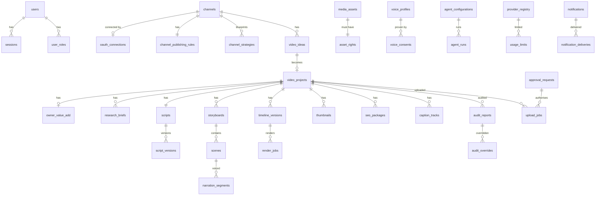

# Database Schema

**Version:** 1.0 (approved at C4, 2026-11-08) · **Date:** 2026-11-08 · **Engine:** PostgreSQL 16+
**Migrations:** Alembic. The DDL is **generated from this document** by `tools/gen_schema_sql.py` into `apps/api/tubeforge/db/schema_v1.sql` (migration 0002); a unit test fails if the committed SQL differs from what this document produces. SQLAlchemy 2.0 models in `apps/api/tubeforge/db/models/` are added per phase for the tables that phase uses and must match this document (Phase 3 decision, recorded in PROJECT_PROGRESS).

---

## 0. Conventions

| Rule | Detail |
|---|---|
| Primary keys | `id uuid` — UUIDv7 (time-ordered), generated in the application |
| Timestamps | `created_at timestamptz NOT NULL DEFAULT now()`, `updated_at timestamptz NOT NULL DEFAULT now()` (trigger). All times stored in **UTC**. |
| Soft delete | `deleted_at timestamptz NULL` **only** on tables marked (SD). Queries use views or default filters. Hard delete is used for data that the Developer Policies require to be deleted, and for secrets. |
| Enums | `text` + `CHECK (col IN (...))`. Enum value sets are listed in §14 and come from `packages/shared/enums.json`, shared by Python and TypeScript. |
| Money | `amount_minor bigint` + `currency char(3)` |
| JSON | `jsonb`. Every jsonb column has a JSON Schema in `packages/shared/schemas/` and is validated in the app. |
| Channel scoping | Every content table has `channel_id uuid NOT NULL REFERENCES channels(id)`, indexed. The repository layer requires a channel scope for every query (NFR-SEC-07). |
| Optimistic locking | `version int NOT NULL DEFAULT 1` on editable entities. Updates use `WHERE version = :v`. |
| Secrets | Columns named `*_enc bytea` hold AES-256-GCM ciphertext (nonce‖ciphertext‖tag), with a `key_id text` for key rotation. Never logged and never returned by the API. |
| Hashes | `*_sha256 char(64)` hex |
| Naming | snake_case, plural table names, FK `<singular>_id` |

`(SD)` = soft delete · `(AO)` = append-only (the application DB role has no UPDATE/DELETE grants)

---

## 1. Identity, access, settings

```sql
CREATE TABLE users (                                  -- (SD)
  id uuid PRIMARY KEY,
  email citext UNIQUE NOT NULL,
  display_name text NOT NULL,
  password_hash text NOT NULL,                        -- argon2id encoded string
  totp_secret_enc bytea NULL, totp_key_id text NULL,
  totp_enabled boolean NOT NULL DEFAULT false,
  failed_login_count int NOT NULL DEFAULT 0,
  locked_until timestamptz NULL,
  timezone text NOT NULL DEFAULT 'Asia/Karachi',
  locale text NOT NULL DEFAULT 'en',
  last_login_at timestamptz NULL,
  created_at, updated_at, deleted_at
);

CREATE TABLE roles (id uuid PK, name text UNIQUE NOT NULL CHECK (name IN ('OWNER','EDITOR','REVIEWER','VIEWER')), description text);
CREATE TABLE permissions (id uuid PK, code text UNIQUE NOT NULL, description text);       -- e.g. 'project.approve', 'upload.execute'
CREATE TABLE role_permissions (role_id uuid REFERENCES roles, permission_id uuid REFERENCES permissions, PRIMARY KEY (role_id, permission_id));
CREATE TABLE user_roles (user_id uuid REFERENCES users, role_id uuid REFERENCES roles,
  channel_id uuid NULL REFERENCES channels,          -- NULL = all channels
  PRIMARY KEY (user_id, role_id, COALESCE(channel_id,'00000000-0000-0000-0000-000000000000')));  -- implemented as unique index

CREATE TABLE sessions (
  id uuid PRIMARY KEY,                                -- random, sent as signed cookie
  user_id uuid NOT NULL REFERENCES users,
  csrf_token_hash char(64) NOT NULL,
  mfa_passed boolean NOT NULL DEFAULT false,
  reauth_at timestamptz NULL,                         -- last step-up re-auth; sensitive actions need it within 5 min (added in Phase 3)
  created_at, last_seen_at timestamptz NOT NULL, expires_at timestamptz NOT NULL,
  revoked_at timestamptz NULL, user_agent text, ip inet
);
CREATE INDEX ON sessions (user_id) WHERE revoked_at IS NULL;

CREATE TABLE user_recovery_codes (                    -- 10 one-time TOTP recovery codes, Argon2-hashed (added in Phase 3)
  id uuid PRIMARY KEY, user_id uuid NOT NULL REFERENCES users,
  code_hash text NOT NULL, used_at timestamptz NULL, created_at
);
CREATE INDEX ON user_recovery_codes (user_id) WHERE used_at IS NULL;

CREATE TABLE system_settings (                        -- single row, id = 1
  id smallint PRIMARY KEY CHECK (id = 1),
  emergency_stop boolean NOT NULL DEFAULT false,
  emergency_stop_at timestamptz NULL, emergency_stop_by uuid NULL REFERENCES users, emergency_stop_reason text NULL,
  publishing_kill_switch boolean NOT NULL DEFAULT false,
  night_render_start time NOT NULL DEFAULT '01:00', night_render_end time NOT NULL DEFAULT '07:00',
  quiet_hours_start time NOT NULL DEFAULT '23:00', quiet_hours_end time NOT NULL DEFAULT '08:00',
  owner_timezone text NOT NULL DEFAULT 'Asia/Karachi',
  disk_budget_gb int NOT NULL DEFAULT 200,
  settings jsonb NOT NULL DEFAULT '{}',              -- validated by schema system_settings.json
  version int NOT NULL DEFAULT 1, updated_at
);

CREATE TABLE kill_switches (
  id uuid PRIMARY KEY,
  scope text NOT NULL CHECK (scope IN ('CHANNEL','AGENT','PROVIDER','PUBLISHING_CHANNEL')),
  target_id text NOT NULL,                            -- channel uuid / agent code / provider code
  active boolean NOT NULL DEFAULT true,
  reason text NOT NULL, set_by uuid NOT NULL REFERENCES users, set_at timestamptz NOT NULL DEFAULT now(),
  cleared_by uuid NULL, cleared_at timestamptz NULL,
  UNIQUE (scope, target_id) -- only one row per target; history lives in audit_log
);

CREATE TABLE audit_log (                              -- (AO)
  id bigserial PRIMARY KEY,
  occurred_at timestamptz NOT NULL DEFAULT now(),
  actor_type text NOT NULL CHECK (actor_type IN ('OWNER','USER','AGENT','AUDITOR','SYSTEM','ORCH')),
  actor_id text NOT NULL,                             -- user uuid / agent code / 'system'
  action text NOT NULL,                               -- e.g. 'project.transition', 'upload.insert', 'setting.update'
  entity_type text NOT NULL, entity_id text NOT NULL,
  channel_id uuid NULL,
  before_sha256 char(64) NULL, after_sha256 char(64) NULL,
  details jsonb NOT NULL DEFAULT '{}',                -- redacted
  request_id uuid NULL, ip inet NULL,
  prev_hash char(64) NOT NULL,                        -- hash chain: sha256(prev_hash || row content)
  row_hash char(64) NOT NULL
);
CREATE INDEX ON audit_log (entity_type, entity_id, occurred_at DESC);
CREATE INDEX ON audit_log (channel_id, occurred_at DESC);
CREATE INDEX ON audit_log (actor_type, actor_id, occurred_at DESC);

CREATE TABLE security_events (                        -- (AO)
  id bigserial PRIMARY KEY, occurred_at timestamptz NOT NULL DEFAULT now(),
  kind text NOT NULL,                                 -- LOGIN_FAILED, LOCKOUT, MFA_FAILED, PERMISSION_DENIED, KILL_SWITCH, EMERGENCY_STOP, TOKEN_REVOKED, VOICE_CONSENT_MISMATCH, SECRET_ACCESS, ...
  severity text NOT NULL CHECK (severity IN ('INFO','WARNING','CRITICAL')),
  user_id uuid NULL, channel_id uuid NULL, details jsonb NOT NULL DEFAULT '{}'
);
```

## 2. Channels, OAuth, strategy

```sql
CREATE TABLE channels (                               -- (SD)
  id uuid PRIMARY KEY,
  name text NOT NULL,
  state text NOT NULL,                                -- enum channel_state
  youtube_channel_id text NULL UNIQUE,                -- 'UC…' after connection
  youtube_handle text NULL,
  content_language text NOT NULL CHECK (content_language IN ('en','es','fr','de','ur')),
  audience_timezone text NOT NULL DEFAULT 'UTC',
  operating_mode text NOT NULL DEFAULT 'MANUAL' CHECK (operating_mode IN ('MANUAL','SEMI_AUTOMATIC','FULLY_AUTOMATIC')),
  private_only_mode boolean NOT NULL DEFAULT true,
  is_test_channel boolean NOT NULL DEFAULT false,
  is_monetised boolean NOT NULL DEFAULT true,         -- "intended for monetisation" → strict licence rules
  local_only boolean NOT NULL DEFAULT false,          -- forbid providers that train on data
  successful_private_test_uploads int NOT NULL DEFAULT 0,
  successful_private_test_runs int NOT NULL DEFAULT 0,
  public_release_test_passed boolean NOT NULL DEFAULT false,
  privacy_policy_url text NULL,
  resume_to_state text NULL,
  version int NOT NULL DEFAULT 1, created_at, updated_at, deleted_at
);

CREATE TABLE channel_publishing_rules (
  channel_id uuid PRIMARY KEY REFERENCES channels,
  max_long_per_day int NOT NULL DEFAULT 1, max_long_per_week int NOT NULL DEFAULT 7,
  max_shorts_per_day int NOT NULL DEFAULT 2,
  min_originality_score numeric(4,1) NOT NULL DEFAULT 70,
  min_audit_scores jsonb NOT NULL DEFAULT '{"content":70,"policy":80,"quality":75,"thumbnail":70}',
  allowed_topics text[] NOT NULL DEFAULT '{}', blocked_topics text[] NOT NULL DEFAULT '{}',
  block_high_inauthentic_risk_in_manual boolean NOT NULL DEFAULT false,   -- OQ-4: warn in MANUAL
  max_stock_runtime_share numeric(3,2) NOT NULL DEFAULT 0.60,
  auto_publish_rules jsonb NULL,                      -- FULLY_AUTO only; schema auto_publish_rules.json
  auto_publish_accepted_at timestamptz NULL, auto_publish_accepted_by uuid NULL,  -- DP-6 express consent
  required_private_test_runs int NOT NULL DEFAULT 10,
  version int NOT NULL DEFAULT 1, updated_at
);

CREATE TABLE onboarding_steps (
  id uuid PRIMARY KEY, channel_id uuid NOT NULL REFERENCES channels,
  step_code text NOT NULL,                            -- CREATE_GOOGLE_ACCOUNT, CREATE_CHANNEL, VERIFY_PHONE, CREATE_GCP_PROJECT, ENABLE_APIS, CONSENT_SCREEN, OAUTH_CLIENT, PRIVACY_POLICY, CONNECT, TEST_UPLOAD
  status text NOT NULL DEFAULT 'TODO' CHECK (status IN ('TODO','DONE','SKIPPED')),
  completed_at timestamptz NULL, notes text NULL,
  UNIQUE (channel_id, step_code)
);

CREATE TABLE oauth_clients (                          -- owner's Google OAuth client (one per GCP project)
  id uuid PRIMARY KEY, label text NOT NULL,
  client_id text NOT NULL, client_secret_enc bytea NULL, key_id text NULL,   -- installed apps may have a non-confidential secret
  gcp_project_id text NULL, publishing_status text NOT NULL DEFAULT 'TESTING' CHECK (publishing_status IN ('TESTING','IN_PRODUCTION')),
  created_at, updated_at
);

CREATE TABLE oauth_connections (
  id uuid PRIMARY KEY,
  channel_id uuid NOT NULL REFERENCES channels,
  oauth_client_id uuid NOT NULL REFERENCES oauth_clients,
  google_account_hint text NULL,                      -- display only
  scopes text[] NOT NULL,
  refresh_token_enc bytea NOT NULL, key_id text NOT NULL,
  access_token_enc bytea NULL, access_token_expires_at timestamptz NULL,
  status text NOT NULL CHECK (status IN ('ACTIVE','NEEDS_REAUTH','REVOKED')),
  last_refresh_at timestamptz NULL, last_error text NULL,
  refresh_expected_expiry timestamptz NULL,           -- TESTING clients: issued_at + 7 days
  authorized_at timestamptz NOT NULL, last_authorization_check_at timestamptz NULL,  -- DP-3 30-day check
  revoked_at timestamptz NULL,
  created_at, updated_at
);
CREATE UNIQUE INDEX ON oauth_connections (channel_id) WHERE status <> 'REVOKED';

CREATE TABLE oauth_pending_flows (                    -- PKCE state, TTL 10 min
  state char(43) PRIMARY KEY, code_verifier_enc bytea NOT NULL, key_id text NOT NULL,
  channel_id uuid NOT NULL REFERENCES channels, scopes text[] NOT NULL,
  created_at timestamptz NOT NULL DEFAULT now(), expires_at timestamptz NOT NULL
);

CREATE TABLE channel_strategies (                     -- blueprint versions
  id uuid PRIMARY KEY, channel_id uuid NULL REFERENCES channels,   -- NULL while still a proposal
  niche_candidate_id uuid NULL REFERENCES niche_candidates,
  version int NOT NULL, status text NOT NULL CHECK (status IN ('DRAFT','PROPOSED','APPROVED','SUPERSEDED','REJECTED')),
  blueprint jsonb NOT NULL,                           -- schema channel_blueprint.json (names, description, brand, pillars, formats, calendar, 50 ideas, risks)
  agent_run_id uuid NULL REFERENCES agent_runs,
  approved_by uuid NULL, approved_at timestamptz NULL,
  created_at, updated_at,
  UNIQUE (channel_id, version)
);
```

## 3. Research, niches, trends, competitors

```sql
CREATE TABLE research_sources (                       -- registry of permitted sources
  id uuid PRIMARY KEY, code text UNIQUE NOT NULL,     -- WIKIPEDIA_PAGEVIEWS, RSS:<slug>, TRENDS_API_ALPHA, OWNER_NOTES, OWN_ANALYTICS
  kind text NOT NULL CHECK (kind IN ('API','RSS','OWNER','OWN_ANALYTICS','WEB_ALLOWLISTED')),
  base_url text NULL, allowed_hosts text[] NOT NULL DEFAULT '{}',
  terms_url text NULL, terms_verified_at date NULL,
  approval_status text NOT NULL CHECK (approval_status IN ('APPROVED','REQUIRES_OWNER_APPROVAL','BLOCKED')),
  enabled boolean NOT NULL DEFAULT false, created_at, updated_at
);

CREATE TABLE source_documents (                       -- fetched untrusted content (sanitised)
  id uuid PRIMARY KEY, source_id uuid NOT NULL REFERENCES research_sources,
  url text NOT NULL, title text NULL, fetched_at timestamptz NOT NULL,
  content_sha256 char(64) NOT NULL, content_text text NOT NULL,   -- sanitised plain text, size-capped
  language text NULL, expires_at timestamptz NOT NULL,
  UNIQUE (url, content_sha256)
);

CREATE TABLE niche_reports (id uuid PK, requested_by uuid REFERENCES users, params jsonb NOT NULL, status text NOT NULL, agent_run_id uuid NULL, created_at, updated_at);

CREATE TABLE niche_candidates (
  id uuid PRIMARY KEY, report_id uuid NOT NULL REFERENCES niche_reports,
  name text NOT NULL, summary text NOT NULL, language text NOT NULL,
  criteria jsonb NOT NULL,                            -- [{code, value 0-100, weight, evidence:[{source_document_id,url,quote}], confidence}]
  opportunity_score numeric(5,2) NOT NULL,            -- recomputed when owner changes weights
  inauthentic_risk text NOT NULL CHECK (inauthentic_risk IN ('LOW','MEDIUM','HIGH')),
  production_difficulty text NOT NULL CHECK (production_difficulty IN ('LOW','MEDIUM','HIGH')),   -- on current hardware profile
  status text NOT NULL DEFAULT 'NEW' CHECK (status IN ('NEW','SHORTLISTED','DISMISSED','CONVERTED')),
  created_at, updated_at
);
CREATE TABLE score_weight_profiles (id uuid PK, name text UNIQUE NOT NULL, weights jsonb NOT NULL, is_default boolean NOT NULL DEFAULT false, updated_at);

CREATE TABLE trend_items (
  id uuid PRIMARY KEY, channel_id uuid NULL REFERENCES channels,
  topic text NOT NULL, summary text NOT NULL, source_document_ids uuid[] NOT NULL,
  signal_strength numeric(5,2) NOT NULL, confidence text NOT NULL CHECK (confidence IN ('LOW','MEDIUM','HIGH')),
  detected_at timestamptz NOT NULL, expires_at timestamptz NOT NULL,
  status text NOT NULL DEFAULT 'ACTIVE' CHECK (status IN ('ACTIVE','USED','DISMISSED','EXPIRED'))
);
CREATE INDEX ON trend_items (channel_id, status, expires_at);

CREATE TABLE keywords (
  id uuid PRIMARY KEY, channel_id uuid NOT NULL REFERENCES channels,
  phrase text NOT NULL, language text NOT NULL,
  evidence jsonb NOT NULL DEFAULT '[]',               -- non-YouTube sources only (ADR-0015)
  notes text NULL, created_at,
  UNIQUE (channel_id, phrase)
);

CREATE TABLE youtube_api_cache (                      -- NON-authorized YouTube data (other channels): ≤ 30 days (DP-2)
  id uuid PRIMARY KEY, requested_by uuid NOT NULL REFERENCES users,
  lookup_kind text NOT NULL CHECK (lookup_kind IN ('CHANNEL','VIDEO','SEARCH')),
  query_key text NOT NULL,                            -- channel id / video id / normalised query
  response jsonb NOT NULL,                            -- single item; never merged across channels (DP-1)
  fetched_at timestamptz NOT NULL,
  expires_at timestamptz NOT NULL CHECK (expires_at <= fetched_at + interval '30 days'),
  UNIQUE (lookup_kind, query_key)
);
CREATE INDEX ON youtube_api_cache (expires_at);
```

## 4. Ideas, projects, scripts, fact-checks

```sql
CREATE TABLE video_ideas (                            -- (SD)
  id uuid PRIMARY KEY, channel_id uuid NOT NULL REFERENCES channels,
  state text NOT NULL,                                -- enum idea_state
  title text NOT NULL, angle text NOT NULL, target_viewer text NULL,
  format text NOT NULL CHECK (format IN ('LONG','SHORT')),
  pillar text NULL, trend_item_id uuid NULL REFERENCES trend_items,
  originality_notes text NULL,
  similarity_max numeric(4,3) NULL, similar_to_id uuid NULL,
  calendar_date date NULL, expires_at timestamptz NULL,
  source text NOT NULL CHECK (source IN ('AGENT','OWNER','BLUEPRINT','REPLICATE')),
  based_on_youtube_video_id text NULL,                -- REPLICATE: the owner's own source video (US-4.6, ADR-0025)
  variation_kind text NULL CHECK (variation_kind IN ('PART_2','NEW_ANGLE','UPDATE','SHORT_FROM_LONG','LONG_FROM_SHORT','SERIES')),
  similarity_to_source numeric(4,3) NULL,
  version int NOT NULL DEFAULT 1, created_at, updated_at, deleted_at
);
CREATE INDEX ON video_ideas (channel_id, state);

CREATE TABLE video_projects (                         -- (SD)
  id uuid PRIMARY KEY, channel_id uuid NOT NULL REFERENCES channels,
  idea_id uuid NULL REFERENCES video_ideas,
  parent_project_id uuid NULL REFERENCES video_projects,   -- Short cut from own long-form
  format text NOT NULL CHECK (format IN ('LONG','SHORT')),
  state text NOT NULL,                                -- enum project_state
  resume_to_state text NULL,
  working_title text NOT NULL,
  packaging_promise jsonb NULL,                       -- {title, thumbnail_text, promise_statement, approved_at} — contract for intro/thumbnail/title
  target_duration_s int NOT NULL,
  render_profile jsonb NOT NULL,                      -- resolution, fps, codec, loudness_lufs
  locked_script_version_id uuid NULL, approved_timeline_version_id uuid NULL, final_render_job_id uuid NULL,
  selected_thumbnail_id uuid NULL, seo_package_id uuid NULL,
  originality_score numeric(5,2) NULL, inauthentic_risk text NULL,
  youtube_video_id text NULL UNIQUE,
  is_test boolean NOT NULL DEFAULT false,
  version int NOT NULL DEFAULT 1, created_at, updated_at, deleted_at
);
CREATE INDEX ON video_projects (channel_id, state);

CREATE TABLE owner_value_add (                        -- what the owner contributed (F3 defence)
  project_id uuid PRIMARY KEY REFERENCES video_projects,
  own_opinion text NULL, own_experience text NULL, own_data text NULL, own_examples text NULL,
  owner_voice text NOT NULL DEFAULT 'NONE' CHECK (owner_voice IN ('NONE','RECORDED','CLONE')),
  owner_footage boolean NOT NULL DEFAULT false, owner_photos boolean NOT NULL DEFAULT false,
  score numeric(5,2) NOT NULL DEFAULT 0, updated_at
);

CREATE TABLE research_briefs (
  id uuid PRIMARY KEY, project_id uuid NOT NULL REFERENCES video_projects, channel_id uuid NOT NULL,
  version int NOT NULL, content jsonb NOT NULL,       -- schema research_brief.json (claims with source refs)
  agent_run_id uuid NULL, status text NOT NULL CHECK (status IN ('DRAFT','SUBMITTED','APPROVED','REJECTED')),
  created_at, UNIQUE (project_id, version)
);

CREATE TABLE scripts (id uuid PRIMARY KEY, project_id uuid UNIQUE NOT NULL REFERENCES video_projects, channel_id uuid NOT NULL, created_at);
CREATE TABLE script_versions (
  id uuid PRIMARY KEY, script_id uuid NOT NULL REFERENCES scripts,
  version int NOT NULL, author_type text NOT NULL CHECK (author_type IN ('AGENT','OWNER')), author_id text NOT NULL,
  body jsonb NOT NULL,                                -- {hook, sections:[{heading,text}], cta}
  plain_text text NOT NULL, word_count int NOT NULL, est_duration_s int NOT NULL,
  content_sha256 char(64) NOT NULL, locked boolean NOT NULL DEFAULT false,
  created_at, UNIQUE (script_id, version)
);

CREATE TABLE fact_check_claims (
  id uuid PRIMARY KEY, project_id uuid NOT NULL REFERENCES video_projects, channel_id uuid NOT NULL,
  subject_type text NOT NULL CHECK (subject_type IN ('RESEARCH_BRIEF','SCRIPT_VERSION')), subject_id uuid NOT NULL,
  claim_text text NOT NULL,
  verdict text NOT NULL CHECK (verdict IN ('SUPPORTED','UNSUPPORTED','CONTRADICTED','OPINION')),
  source_document_ids uuid[] NOT NULL DEFAULT '{}', explanation text NOT NULL,
  owner_override_reason text NULL, overridden_by uuid NULL, overridden_at timestamptz NULL,
  agent_run_id uuid NULL, created_at
);
CREATE INDEX ON fact_check_claims (subject_type, subject_id, verdict);
```

## 5. Storyboard, media assets, rights, stock, voice

```sql
CREATE TABLE storyboards (id uuid PK, project_id uuid NOT NULL REFERENCES video_projects, channel_id uuid NOT NULL, version int NOT NULL, created_at, UNIQUE (project_id, version));
CREATE TABLE scenes (
  id uuid PRIMARY KEY, storyboard_id uuid NOT NULL REFERENCES storyboards, position int NOT NULL,
  narration text NOT NULL, visual_instruction text NOT NULL, on_screen_text text NULL,
  duration_s numeric(6,2) NOT NULL, style text NULL,
  UNIQUE (storyboard_id, position)
);

CREATE TABLE media_assets (                           -- (SD) every file in the CAS
  id uuid PRIMARY KEY, channel_id uuid NULL REFERENCES channels,   -- NULL = shared library
  project_id uuid NULL REFERENCES video_projects,
  kind text NOT NULL,                                 -- enum asset_kind
  mime_type text NOT NULL, size_bytes bigint NOT NULL,
  sha256 char(64) NOT NULL,                           -- path = data/media/blobs/sha256/ab/cd/<sha>.<ext>
  width int NULL, height int NULL, duration_s numeric(10,3) NULL,
  origin text NOT NULL,                               -- enum asset_origin
  retention_class text NOT NULL CHECK (retention_class IN ('MASTER','INTERMEDIATE','CACHE','SENSITIVE')),
  encrypted boolean NOT NULL DEFAULT false,
  quarantined boolean NOT NULL DEFAULT false,
  created_by_type text NOT NULL, created_by_id text NOT NULL,
  created_at, deleted_at
);
CREATE INDEX ON media_assets (sha256);
CREATE INDEX ON media_assets (project_id, kind);

CREATE TABLE asset_rights (                           -- 1:1 with media_assets; REQUIRED before render
  asset_id uuid PRIMARY KEY REFERENCES media_assets,
  rights_basis text NOT NULL,                         -- enum rights_basis
  licence_name text NOT NULL,                         -- e.g. 'CC0-1.0', 'Pexels License', 'Shutterstock Standard', 'Owner-created'
  licence_url text NULL,
  commercial_use_allowed boolean NOT NULL,
  editorial_only boolean NOT NULL DEFAULT false,
  attribution_required boolean NOT NULL DEFAULT false, attribution_text text NULL,
  source_provider text NULL, source_asset_id text NULL, source_url text NULL,
  proof_asset_id uuid NULL REFERENCES media_assets,   -- receipt / licence PDF / screenshot
  lineage jsonb NOT NULL DEFAULT '{}',                -- e.g. {"model":"kokoro-82m","voice":"af_heart","provider_registry_id":...}
  verified_by uuid NULL, verified_at timestamptz NULL,
  created_at, updated_at,
  CHECK (NOT (editorial_only AND commercial_use_allowed))
);

CREATE TABLE stock_purchases (                        -- ADR-0020, paid providers only
  id uuid PRIMARY KEY, channel_id uuid NULL REFERENCES channels,
  provider_code text NOT NULL, provider_asset_id text NOT NULL,
  state text NOT NULL,                                -- enum stock_purchase_state
  licence_type text NOT NULL, price_minor bigint NOT NULL, currency char(3) NOT NULL,
  quoted_at timestamptz NOT NULL, confirmed_by uuid NULL REFERENCES users, confirmed_at timestamptz NULL,
  provider_order_ref text NULL, asset_id uuid NULL REFERENCES media_assets,
  failure_reason text NULL, created_at, updated_at
);

CREATE TABLE voice_profiles (                         -- ADR-0019, owner only
  id uuid PRIMARY KEY, owner_user_id uuid NOT NULL REFERENCES users,
  label text NOT NULL, state text NOT NULL,           -- enum voice_profile_state
  engine text NOT NULL CHECK (engine IN ('OPENVOICE_V2','CHATTERBOX_ML')),
  sample_asset_ids uuid[] NOT NULL DEFAULT '{}',      -- SENSITIVE, encrypted assets
  embedding_enc bytea NULL, key_id text NULL,
  sample_seconds numeric(8,2) NOT NULL DEFAULT 0,
  created_at, updated_at, deleted_at timestamptz NULL  -- hard purge job runs after delete
);

CREATE TABLE voice_consents (                         -- (AO)
  id uuid PRIMARY KEY, voice_profile_id uuid NOT NULL REFERENCES voice_profiles,
  consent_text text NOT NULL, one_time_code char(8) NOT NULL,
  recording_asset_id uuid NOT NULL REFERENCES media_assets,
  stt_transcript text NOT NULL, code_matched boolean NOT NULL,
  speaker_similarity numeric(4,3) NOT NULL, threshold numeric(4,3) NOT NULL,
  result text NOT NULL CHECK (result IN ('ACCEPTED','REJECTED')),
  recorded_at timestamptz NOT NULL DEFAULT now()
);

CREATE TABLE voice_configurations (                   -- per channel default narration choice
  id uuid PRIMARY KEY, channel_id uuid NOT NULL REFERENCES channels,
  language text NOT NULL,
  source text NOT NULL CHECK (source IN ('OWNER_RECORDING','OWNER_CLONE','TTS')),
  tts_provider_code text NULL, tts_voice_id text NULL, voice_profile_id uuid NULL REFERENCES voice_profiles,
  clone_mode text NULL CHECK (clone_mode IN ('CONVERTER','ZERO_SHOT')),
  speaking_rate numeric(3,2) NOT NULL DEFAULT 1.0,
  UNIQUE (channel_id, language)
);

CREATE TABLE narration_segments (
  id uuid PRIMARY KEY, project_id uuid NOT NULL REFERENCES video_projects, scene_id uuid NOT NULL REFERENCES scenes,
  source text NOT NULL CHECK (source IN ('OWNER_RECORDING','OWNER_CLONE','TTS')),
  audio_asset_id uuid NOT NULL REFERENCES media_assets, text_sha256 char(64) NOT NULL,
  take int NOT NULL DEFAULT 1, selected boolean NOT NULL DEFAULT true, created_at
);
CREATE UNIQUE INDEX ON narration_segments (scene_id) WHERE selected;
```

## 6. Timeline, render, thumbnails, SEO, captions, disclosure

```sql
CREATE TABLE timeline_versions (
  id uuid PRIMARY KEY, project_id uuid NOT NULL REFERENCES video_projects, channel_id uuid NOT NULL,
  version int NOT NULL, schema_version text NOT NULL,
  timeline jsonb NOT NULL,                            -- schema timeline.json
  content_sha256 char(64) NOT NULL, created_by_type text NOT NULL, created_by_id text NOT NULL,
  created_at, UNIQUE (project_id, version)
);

CREATE TABLE render_jobs (
  id uuid PRIMARY KEY, project_id uuid NOT NULL REFERENCES video_projects, channel_id uuid NOT NULL,
  timeline_version_id uuid NOT NULL REFERENCES timeline_versions,
  kind text NOT NULL CHECK (kind IN ('PROXY','FINAL')),
  state text NOT NULL,                                -- enum render_state
  preset jsonb NOT NULL, segments_total int NOT NULL DEFAULT 1, segments_done int NOT NULL DEFAULT 0,
  attempt int NOT NULL DEFAULT 0, output_asset_id uuid NULL REFERENCES media_assets,
  qc_report jsonb NULL, error_class text NULL, error_detail text NULL,
  started_at timestamptz NULL, finished_at timestamptz NULL, created_at, updated_at,
  idempotency_key text UNIQUE NOT NULL                -- project:timeline_sha:kind:preset_sha
);

CREATE TABLE thumbnails (
  id uuid PRIMARY KEY, project_id uuid NOT NULL REFERENCES video_projects, channel_id uuid NOT NULL,
  asset_id uuid NOT NULL REFERENCES media_assets, aspect text NOT NULL CHECK (aspect IN ('16:9','9:16')),
  concept text NOT NULL, overlay_text text NULL,
  checks jsonb NOT NULL,                              -- dimensions, size, contrast, small-size readability score
  passed_checks boolean NOT NULL, selected boolean NOT NULL DEFAULT false, created_at
);
CREATE UNIQUE INDEX ON thumbnails (project_id) WHERE selected;

CREATE TABLE seo_packages (
  id uuid PRIMARY KEY, project_id uuid NOT NULL REFERENCES video_projects, channel_id uuid NOT NULL,
  version int NOT NULL,
  title_options jsonb NOT NULL, selected_title text NULL CHECK (char_length(selected_title) <= 100 AND selected_title !~ '[<>]'),
  description text NOT NULL CHECK (octet_length(description) <= 5000),   -- 5000 BYTES (Urdu ≈ 2–3 bytes/char); no '<' or '>'
  tags text[] NOT NULL DEFAULT '{}', hashtags text[] NOT NULL DEFAULT '{}',
  chapters jsonb NOT NULL DEFAULT '[]',               -- [{start_s,title}] validated vs final render
  playlist_suggestions jsonb NOT NULL DEFAULT '[]',
  category_id text NULL, default_language text NOT NULL, default_audio_language text NOT NULL,
  made_for_kids boolean NULL,                         -- NULL until OWNER decides; upload refuses NULL
  made_for_kids_decided_by uuid NULL, made_for_kids_decided_at timestamptz NULL,
  misleading_check jsonb NULL,
  content_sha256 char(64) NOT NULL, created_at, UNIQUE (project_id, version)
);

CREATE TABLE disclosure_assessments (                 -- containsSyntheticMedia decision (F4/Y7)
  id uuid PRIMARY KEY, project_id uuid NOT NULL REFERENCES video_projects, channel_id uuid NOT NULL,
  recommended_value boolean NOT NULL, reasons jsonb NOT NULL,   -- [{element, realistic:bool, rule_ref}]
  owner_confirmed_value boolean NULL, confirmed_by uuid NULL, confirmed_at timestamptz NULL,
  agent_run_id uuid NULL, created_at
);

CREATE TABLE caption_tracks (
  id uuid PRIMARY KEY, project_id uuid NOT NULL REFERENCES video_projects, channel_id uuid NOT NULL,
  language text NOT NULL, format text NOT NULL CHECK (format IN ('SRT','VTT')),
  asset_id uuid NOT NULL REFERENCES media_assets, method text NOT NULL CHECK (method IN ('SCRIPT_ALIGNED','TRANSCRIBED','OWNER_EDITED')),
  owner_reviewed boolean NOT NULL DEFAULT false, sync_check jsonb NULL, created_at,
  UNIQUE (project_id, language)
);
```

### 6a. External editors (ADR-0021)

```sql
CREATE TABLE external_editors (
  code text PRIMARY KEY,                              -- 'canva','capcut','inshot','filmora','davinci','kdenlive','shotcut','openshot','gimp','krita','photopea','adobe_express','premiere','photoshop','custom:<slug>'
  name text NOT NULL, kind text NOT NULL CHECK (kind IN ('DESKTOP','WEB','MOBILE')),
  supports_video boolean NOT NULL, supports_thumbnail boolean NOT NULL,
  launch_type text NOT NULL CHECK (launch_type IN ('EXE','URL','MANUAL')),
  exe_path text NULL, url text NULL,
  enabled boolean NOT NULL DEFAULT false,
  licence_notes text NULL,                            -- e.g. 'Library music not cleared for monetised YouTube on free plan'
  watermark_on_free_plan boolean NULL,
  updated_at
);

CREATE TABLE external_edit_sessions (
  id uuid PRIMARY KEY, project_id uuid NOT NULL REFERENCES video_projects, channel_id uuid NOT NULL,
  subject text NOT NULL CHECK (subject IN ('VIDEO','THUMBNAIL')),
  editor_code text NOT NULL REFERENCES external_editors,
  handoff_path text NOT NULL, source_asset_ids uuid[] NOT NULL,
  state text NOT NULL CHECK (state IN ('HANDED_OFF','RETURNED','CANCELLED')),
  returned_asset_id uuid NULL REFERENCES media_assets,
  declaration jsonb NULL,                             -- schema external_edit_declaration.json (app plan, library assets+licences, AI content)
  started_at timestamptz NOT NULL DEFAULT now(), returned_at timestamptz NULL
);
CREATE INDEX ON external_edit_sessions (project_id, state);
```

## 7. Audits, approvals, policy

```sql
CREATE TABLE audit_reports (                          -- written ONLY by auditor roles (DB role grants + app check)
  id uuid PRIMARY KEY, project_id uuid NOT NULL REFERENCES video_projects, channel_id uuid NOT NULL,
  audit_type text NOT NULL CHECK (audit_type IN ('CONTENT','COPYRIGHT','POLICY','QUALITY','THUMBNAIL')),
  subject_sha256 char(64) NOT NULL,                   -- hash of what was audited (render+metadata+thumb)
  result text NOT NULL CHECK (result IN ('PASSED','WARNING','FAILED')),
  critical boolean NOT NULL DEFAULT false,
  score numeric(5,2) NOT NULL,
  findings jsonb NOT NULL,                            -- [{code, severity, message, affected_component, responsible_agent, evidence, remediation}]
  auditor_agent text NOT NULL, agent_run_id uuid NULL, created_at
);
CREATE INDEX ON audit_reports (project_id, audit_type, created_at DESC);

CREATE TABLE audit_overrides (                        -- (AO)
  id uuid PRIMARY KEY, audit_report_id uuid NOT NULL REFERENCES audit_reports,
  overridden_by uuid NOT NULL REFERENCES users, reason text NOT NULL CHECK (char_length(reason) >= 20),
  created_at timestamptz NOT NULL DEFAULT now()
);

CREATE TABLE approval_requests (
  id uuid PRIMARY KEY, channel_id uuid NULL REFERENCES channels,
  subject_type text NOT NULL,                         -- RESEARCH, SCRIPT, ROUGH_CUT, UPLOAD_PACKAGE, BLUEPRINT, AUTO_RULES, STOCK_PURCHASE, PRIVATE_ONLY_OFF, MODE_CHANGE, PAID_PROVIDER_ENABLE
  subject_id uuid NOT NULL, subject_sha256 char(64) NOT NULL,
  state text NOT NULL,                                -- enum approval_state
  requested_by_type text NOT NULL, requested_at timestamptz NOT NULL DEFAULT now(),
  decided_by uuid NULL REFERENCES users, decided_at timestamptz NULL,
  auto_rule_id text NULL, comment text NULL,
  payload jsonb NOT NULL DEFAULT '{}',                -- e.g. upload choices: privacy, publishAt, madeForKids, synthetic
  expires_at timestamptz NOT NULL
);
CREATE INDEX ON approval_requests (state, requested_at) WHERE state = 'PENDING';
```

## 8. YouTube: uploads, quota, analytics, comments

```sql
CREATE TABLE upload_jobs (
  id uuid PRIMARY KEY, project_id uuid NOT NULL REFERENCES video_projects, channel_id uuid NOT NULL,
  approval_request_id uuid NOT NULL REFERENCES approval_requests,
  file_asset_id uuid NOT NULL REFERENCES media_assets, file_sha256 char(64) NOT NULL,
  state text NOT NULL,                                -- enum upload_state
  privacy_status text NOT NULL CHECK (privacy_status IN ('private','unlisted','public')),   -- NOT NULL = explicit (ADR-0016)
  publish_at timestamptz NULL CHECK (publish_at IS NULL OR privacy_status = 'private'),
  made_for_kids boolean NOT NULL, contains_synthetic_media boolean NOT NULL,
  session_started_at timestamptz NULL,                -- duplicate detection window (YOUTUBE_API_INTEGRATION §6)
  session_uri_enc bytea NULL, key_id text NULL, bytes_total bigint NOT NULL, bytes_confirmed bigint NOT NULL DEFAULT 0,
  youtube_video_id text NULL, processing_status text NULL,
  steps jsonb NOT NULL DEFAULT '{}',                  -- {thumbnail:{state,attempts,error}, captions:{...}, playlist:{...}}
  attempt int NOT NULL DEFAULT 0, error_class text NULL, error_detail text NULL,
  is_test boolean NOT NULL DEFAULT false,
  created_at, updated_at
);
CREATE UNIQUE INDEX upload_once ON upload_jobs (project_id, file_sha256) WHERE state NOT IN ('FAILED','REJECTED');

CREATE TABLE quota_ledger (                           -- (AO) one row per API call
  id bigserial PRIMARY KEY, occurred_at timestamptz NOT NULL DEFAULT now(),
  pt_day date NOT NULL,                               -- America/Los_Angeles calendar day
  gcp_project text NOT NULL, bucket text NOT NULL CHECK (bucket IN ('VIDEO_UPLOADS','SEARCH','DEFAULT','ANALYTICS')),
  method text NOT NULL, units int NOT NULL, reservation_id uuid NULL,
  channel_id uuid NULL, job_id text NULL, http_status int NULL, error_reason text NULL
);
CREATE INDEX ON quota_ledger (gcp_project, pt_day, bucket);

CREATE TABLE quota_reservations (
  id uuid PRIMARY KEY, gcp_project text NOT NULL, pt_day date NOT NULL, bucket text NOT NULL,
  units int NOT NULL, purpose text NOT NULL, job_id text NULL,
  state text NOT NULL CHECK (state IN ('HELD','SETTLED','RELEASED')), created_at, expires_at timestamptz NOT NULL
);

CREATE TABLE quota_config (                           -- costs & limits from config, not hard-coded (F2)
  gcp_project text NOT NULL, bucket text NOT NULL, daily_limit int NOT NULL, reserve_pct int NOT NULL DEFAULT 10,
  research_share_pct int NOT NULL DEFAULT 30, method_costs jsonb NOT NULL, verified_at date NOT NULL, source_url text NOT NULL,
  PRIMARY KEY (gcp_project, bucket)
);

CREATE TABLE analytics_snapshots (                    -- own channels only (authorized data, DP-3)
  id uuid PRIMARY KEY, channel_id uuid NOT NULL REFERENCES channels,
  youtube_video_id text NULL,                         -- NULL = channel-level
  snapshot_date date NOT NULL, metrics jsonb NOT NULL, -- views, engagedViews, watchTime, avgViewDuration, ctr, subsGained, subsLost, trafficSources
  fetched_at timestamptz NOT NULL,
  UNIQUE (channel_id, youtube_video_id, snapshot_date)
);

CREATE TABLE growth_suggestions (
  id uuid PRIMARY KEY, channel_id uuid NOT NULL REFERENCES channels, project_id uuid NULL,
  kind text NOT NULL, suggestion text NOT NULL, evidence jsonb NOT NULL,
  state text NOT NULL DEFAULT 'NEW' CHECK (state IN ('NEW','ACCEPTED','REJECTED','APPLIED')),
  decided_by uuid NULL, decided_at timestamptz NULL, agent_run_id uuid NULL, created_at
);

CREATE TABLE comment_suggestions (                    -- comment moderation assistant (US-10.3), off by default
  id uuid PRIMARY KEY, channel_id uuid NOT NULL REFERENCES channels, youtube_comment_id text NOT NULL,
  comment_snapshot jsonb NOT NULL, fetched_at timestamptz NOT NULL, expires_at timestamptz NOT NULL,
  suggestion_kind text NOT NULL CHECK (suggestion_kind IN ('REPLY','HOLD_FOR_REVIEW','MARK_SPAM','NONE')),
  suggested_reply text NULL,
  state text NOT NULL DEFAULT 'NEW' CHECK (state IN ('NEW','APPROVED','REJECTED','EXECUTED')),
  decided_by uuid NULL, decided_at timestamptz NULL, created_at,
  UNIQUE (channel_id, youtube_comment_id)
);

CREATE TABLE data_deletion_tasks (                    -- DP-4 deadlines
  id uuid PRIMARY KEY, channel_id uuid NULL, reason text NOT NULL CHECK (reason IN ('DISCONNECT','OWNER_REQUEST','RETENTION','REVOCATION_DETECTED')),
  scope jsonb NOT NULL, due_at timestamptz NOT NULL, completed_at timestamptz NULL, created_at
);
```

## 9. Agents, workflow, jobs

```sql
CREATE TABLE agent_configurations (
  agent_code text PRIMARY KEY,                        -- e.g. 'A11_SCRIPTWRITING'
  name text NOT NULL, version text NOT NULL, is_auditor boolean NOT NULL,
  enabled boolean NOT NULL DEFAULT true,
  prompt_version text NOT NULL, provider_chain jsonb NOT NULL,
  limits jsonb NOT NULL,                              -- {calls_per_day, tokens_per_day, max_runtime_s}
  permissions jsonb NOT NULL,                         -- read/write scopes
  updated_at, updated_by uuid NULL
);

CREATE TABLE agent_runs (
  id uuid PRIMARY KEY, agent_code text NOT NULL REFERENCES agent_configurations,
  channel_id uuid NULL, project_id uuid NULL, job_id text NULL,
  input_sha256 char(64) NOT NULL, input jsonb NOT NULL, output jsonb NULL,
  status text NOT NULL CHECK (status IN ('RUNNING','SUCCEEDED','FAILED','REPAIRED','ABORTED','WAITING_QUOTA')),
  provider_code text NULL, model text NULL, tokens_in int NULL, tokens_out int NULL,
  duration_ms int NULL, repair_attempted boolean NOT NULL DEFAULT false,
  error_class text NULL, error_detail text NULL, quality_score numeric(5,2) NULL,
  started_at timestamptz NOT NULL, finished_at timestamptz NULL
);
CREATE INDEX ON agent_runs (agent_code, started_at DESC);
CREATE INDEX ON agent_runs (project_id);

CREATE TABLE workflow_transitions (                   -- (AO)
  id bigserial PRIMARY KEY, entity_type text NOT NULL, entity_id uuid NOT NULL, channel_id uuid NULL,
  from_state text NOT NULL, to_state text NOT NULL, event text NOT NULL,
  actor_type text NOT NULL, actor_id text NOT NULL, reason text NULL,
  idempotency_key text NOT NULL, occurred_at timestamptz NOT NULL DEFAULT now(),
  UNIQUE (entity_id, idempotency_key)
);
CREATE INDEX ON workflow_transitions (entity_type, entity_id, occurred_at);

-- Procrastinate creates and owns its own tables (procrastinate_jobs, procrastinate_events, ...) via its migrations.
CREATE TABLE job_meta (                               -- our extra job info, keyed by procrastinate job id
  procrastinate_job_id bigint PRIMARY KEY, kind text NOT NULL, entity_id uuid NULL,
  idempotency_key text UNIQUE NOT NULL, ram_required_mb int NOT NULL DEFAULT 200,
  wait_state text NULL CHECK (wait_state IN ('WAITING_RESOURCES','WAITING_QUOTA')), wait_until timestamptz NULL,
  checkpoint jsonb NULL, created_at
);
```

## 10. Providers, usage, costs

```sql
CREATE TABLE provider_registry (                      -- seeded from FREE_TIER_PROVIDER_MATRIX
  code text PRIMARY KEY,                              -- 'gemini:gemini-3.8-flash', 'groq:gpt-oss-120b', 'kokoro:82m', 'piper:de_DE-thorsten-medium', 'stock:pexels', 'stock:shutterstock'
  capability text NOT NULL CHECK (capability IN ('LLM','TTS','VOICE_CLONE','STT','IMAGE','VIDEO_GEN','STOCK','NOTIFY','RESEARCH')),
  tier text NOT NULL CHECK (tier IN ('L','F','P')),
  enabled boolean NOT NULL DEFAULT false,
  paid_activation_step int NOT NULL DEFAULT 0 CHECK (paid_activation_step BETWEEN 0 AND 2),   -- Tier P needs 2 confirmed steps
  licence text NOT NULL, licence_url text NULL, lineage text NULL,
  commercial_use text NOT NULL CHECK (commercial_use IN ('YES','NO','WITH_ATTRIBUTION','REVIEW')),
  data_use_training boolean NULL,                     -- true = provider may use content to improve products
  languages text[] NOT NULL DEFAULT '{}',
  limits jsonb NOT NULL DEFAULT '{}',                 -- {rpm, rpd, tpm, tpd, chars_per_day, monthly_budget_minor}
  model_sha256 char(64) NULL,
  verified_at date NOT NULL, verified_url text NOT NULL, notes text NULL,
  updated_at
);

CREATE TABLE provider_credentials (                   -- API keys (owner's own); never returned by API
  provider_code text PRIMARY KEY REFERENCES provider_registry,
  secret_enc bytea NOT NULL, key_id text NOT NULL, label text NULL, created_at, updated_at
);

CREATE TABLE usage_limits (
  id uuid PRIMARY KEY, provider_code text NOT NULL REFERENCES provider_registry,
  scope text NOT NULL CHECK (scope IN ('GLOBAL','TASK','CHANNEL')), scope_ref text NULL,
  metric text NOT NULL CHECK (metric IN ('REQUESTS','TOKENS','CHARS','SECONDS','IMAGES','MONEY_MINOR')),
  period text NOT NULL CHECK (period IN ('MINUTE','DAY','MONTH')),
  limit_value bigint NOT NULL, reset_tz text NOT NULL DEFAULT 'America/Los_Angeles',
  UNIQUE (provider_code, scope, scope_ref, metric, period)
);

CREATE TABLE usage_records (                          -- (AO) reservations + settlements
  id bigserial PRIMARY KEY, occurred_at timestamptz NOT NULL DEFAULT now(),
  provider_code text NOT NULL, period_key text NOT NULL,   -- e.g. '2026-11-08' or '2026-11'
  metric text NOT NULL, amount bigint NOT NULL, kind text NOT NULL CHECK (kind IN ('RESERVE','SETTLE','RELEASE')),
  agent_run_id uuid NULL, channel_id uuid NULL, task text NULL
);
CREATE INDEX ON usage_records (provider_code, period_key, metric);

CREATE TABLE gateway_cache (
  cache_key char(64) PRIMARY KEY, provider_code text NOT NULL, response jsonb NOT NULL,
  created_at timestamptz NOT NULL DEFAULT now(), expires_at timestamptz NOT NULL, hits int NOT NULL DEFAULT 0
);

CREATE TABLE cost_budgets (                           -- includes stock budget (default 0)
  id uuid PRIMARY KEY, scope text NOT NULL CHECK (scope IN ('STOCK','PAID_PROVIDER')), provider_code text NULL,
  month char(7) NOT NULL, cap_minor bigint NOT NULL DEFAULT 0, spent_minor bigint NOT NULL DEFAULT 0, currency char(3) NOT NULL DEFAULT 'USD',
  CHECK (spent_minor <= cap_minor), UNIQUE (scope, provider_code, month)
);
```

## 11. Notifications

```sql
CREATE TABLE notification_preferences (
  id uuid PRIMARY KEY, user_id uuid NOT NULL REFERENCES users,
  event_type text NOT NULL, channel text NOT NULL CHECK (channel IN ('IN_APP','TELEGRAM','EMAIL','WHATSAPP')),
  enabled boolean NOT NULL, digest text NOT NULL DEFAULT 'NONE' CHECK (digest IN ('NONE','DAILY','WEEKLY')),
  UNIQUE (user_id, event_type, channel)
);

CREATE TABLE notification_targets (                   -- telegram chat id, email address (encrypted)
  id uuid PRIMARY KEY, user_id uuid NOT NULL REFERENCES users, channel text NOT NULL,
  target_enc bytea NOT NULL, key_id text NOT NULL, verified_at timestamptz NULL, UNIQUE (user_id, channel)
);

CREATE TABLE notifications (
  id uuid PRIMARY KEY, user_id uuid NOT NULL REFERENCES users, channel_id uuid NULL,
  event_type text NOT NULL, severity text NOT NULL CHECK (severity IN ('INFO','WARNING','CRITICAL')),
  title text NOT NULL, body text NOT NULL, link text NULL, entity_type text NULL, entity_id uuid NULL,
  dedup_key text NOT NULL, created_at timestamptz NOT NULL DEFAULT now(), read_at timestamptz NULL
);
CREATE INDEX ON notifications (user_id, read_at, created_at DESC);
CREATE INDEX ON notifications (dedup_key, created_at DESC);

CREATE TABLE notification_deliveries (
  id uuid PRIMARY KEY, notification_id uuid NOT NULL REFERENCES notifications,
  channel text NOT NULL, state text NOT NULL,         -- enum delivery_state
  attempts int NOT NULL DEFAULT 0, next_attempt_at timestamptz NULL, provider_message_id text NULL,
  last_error text NULL, sent_at timestamptz NULL, UNIQUE (notification_id, channel)
);
```

## 12. Operations

```sql
CREATE TABLE system_health_samples (id bigserial PK, sampled_at timestamptz NOT NULL DEFAULT now(),
  ram_free_mb int, disk_free_gb numeric(8,2), cpu_pct numeric(5,2), queue_depth jsonb, failed_jobs_24h int);
CREATE TABLE backups (id uuid PK, kind text NOT NULL CHECK (kind IN ('DB','SECRETS','MEDIA')), path text NOT NULL,
  size_bytes bigint, sha256 char(64), started_at timestamptz, finished_at timestamptz, status text NOT NULL, error text NULL, restore_tested_at timestamptz NULL);
CREATE TABLE provider_reverify_reminders (provider_code text PRIMARY KEY REFERENCES provider_registry, due_at date NOT NULL);
CREATE TABLE adr_references (adr_id text PRIMARY KEY, title text NOT NULL, status text NOT NULL, path text NOT NULL);

CREATE TABLE idempotency_keys (                       -- BACKEND_SPECIFICATION §1: replay the first response for 24 h (added in Phase 3)
  user_id uuid NOT NULL REFERENCES users, key uuid NOT NULL,
  method text NOT NULL, path text NOT NULL, request_sha256 char(64) NOT NULL,
  status_code int NULL, response_body jsonb NULL,     -- NULL while the first request is still running
  created_at, expires_at timestamptz NOT NULL,
  PRIMARY KEY (user_id, key)
);
CREATE INDEX ON idempotency_keys (expires_at);
```

## 13. Relationships (summary)



## 14. Enum value sets (`packages/shared/enums.json`)

| Enum | Values |
|---|---|
| channel_state | PROPOSED, APPROVED, REJECTED, ONBOARDING, CONNECTED, ACTIVE, PAUSED, NEEDS_REAUTH, DISCONNECTING, DISCONNECTED |
| idea_state | SUGGESTED, SHORTLISTED, SCHEDULED, APPROVED, IN_PRODUCTION, PRODUCED, DISCARDED |
| project_state | IDEA, RESEARCHING, RESEARCH_REVIEW, SCRIPTING, SCRIPT_REVIEW, STORYBOARDING, ASSET_GENERATION, VOICEOVER, ASSEMBLY, ROUGH_CUT_REVIEW, EXTERNAL_EDITING, RENDERING, PACKAGING, QC_AUDIT, BLOCKED, READY_FOR_APPROVAL, APPROVED, UPLOADING, PROCESSING, SCHEDULED, PRIVATE_DONE, PUBLISHED, ANALYZING, ARCHIVED, PAUSED, CANCELLED, FAILED |
| render_state | QUEUED, WAITING_RESOURCES, RUNNING, SEGMENT_DONE, CONCATENATING, QC_CHECK, SUCCEEDED, QC_FAILED, RETRYING, FAILED, CANCELLED |
| upload_state | PREFLIGHT, REJECTED, WAITING_QUOTA, SESSION_STARTED, TRANSFERRING, RESUMING, UPLOADED, SETTING_THUMBNAIL, SETTING_CAPTIONS, SETTING_PLAYLIST, POLLING_PROCESSING, COMPLETED, PROCESSING_FAILED, FAILED |
| approval_state | PENDING, APPROVED, CHANGES_REQUESTED, REJECTED, EXPIRED, INVALIDATED |
| delivery_state | CREATED, SUPPRESSED, DEFERRED, DIGEST_PENDING, QUEUED, SENT, RETRYING, FAILED, READ |
| voice_profile_state | RECORDING_SAMPLES, CONSENT_PENDING, VERIFYING, READY, DISABLED, REJECTED, DELETED |
| stock_purchase_state | QUOTED, REFUSED, CONFIRMED, LICENSED, DOWNLOADED, FAILED |
| asset_kind | IMAGE, VIDEO_CLIP, AUDIO_NARRATION, AUDIO_MUSIC, AUDIO_SFX, FONT, RENDER_PROXY, RENDER_FINAL, THUMBNAIL, CAPTION, VOICE_SAMPLE, LICENCE_PROOF, OTHER |
| asset_origin | OWNER_UPLOAD, OWNER_RECORDING, PROCEDURAL, TTS, VOICE_CLONE, STOCK_FREE_API, STOCK_PAID_API, STOCK_MANUAL_IMPORT, CC0_IMPORT, AI_IMAGE, RENDER, EXTERNAL_EDIT |
| rights_basis | OWNER_CREATED, SYSTEM_GENERATED, CC0, PUBLIC_DOMAIN, CC_BY, STOCK_FREE_LICENCE, STOCK_PAID_LICENCE, YOUTUBE_AUDIO_LIBRARY, MODEL_OUTPUT |

## 15. Retention jobs (maintenance queue)

| Job | Schedule | Rule |
|---|---|---|
| `purge_youtube_api_cache` | hourly | delete rows where `expires_at < now()` (DP-2) |
| `reauthorize_check` | daily | for each ACTIVE connection with `last_authorization_check_at < now()-25 days`: `channels.list(mine)` + check that stored video IDs still exist; delete data for videos that are gone (DP-3) |
| `deletion_deadlines` | hourly | run due `data_deletion_tasks`; CRITICAL alert if `due_at` is passed and not completed (DP-4, 7 days) |
| `expire_source_documents` | daily | delete expired research documents (default 90 days; non-YouTube) |
| `intermediate_cleanup_offer` | daily | intermediates 30 days after publish → owner-confirmed cleanup (OQ-1) |
| `voice_profile_purge` | hourly | hard-delete samples and embeddings of profiles with `deleted_at` set |
| `oauth_pending_cleanup` | 10 min | delete expired PKCE rows |
