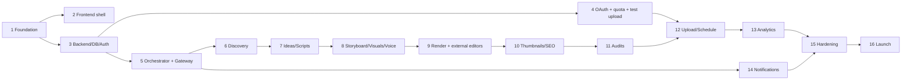

# Implementation Roadmap

**Version:** 1.0 (approved at C6, 2026-11-08) · **Date:** 2026-11-08
**Rule:** do not start phase N+1 until phase N's acceptance tests pass **and the owner says "approved"** (master prompt §20). Each phase ends with a report (modules, files, DB changes, APIs, agents, tests + results, free-tier services, resource use, limitations, remaining tasks) appended to `PROJECT_PROGRESS.md`.

## Overview

| Phase | Name | Depends on | Owner action needed |
|---|---|---|---|

| 1 | Foundation & repository | C6 approval | Install PostgreSQL 16 for Windows (guided), confirm D: free space |
| 2 | Frontend shell | Phase 1 | — |
| 3 | Backend, database & auth | Phase 1 (Phase 2 in parallel) | — |
| 4 | Channel onboarding, OAuth & quota ledger | Phase 3 | Create Google Cloud project (no billing), OAuth client, test channel, privacy-policy name/email |
| 5 | Orchestrator & agent infrastructure | Phase 3 (Phase 4 for YouTube-related transitions) | Create Gemini API key in a no-billing project; Groq free account; read limits from consoles |
| 6 | Niche discovery & trends | Phase 5 | — |
| 7 | Ideas, research, fact-check & scripts | Phase 6 (blueprint) or manual channel | — |
| 8 | Storyboards, visuals, voice (incl. own-voice clone) & stock | Phase 7 | Record voice samples; listen to Urdu voices; optionally get Pexels/Pixabay free keys |
| 9 | Editing & rendering | Phase 8 | — |
| 10 | Thumbnails & SEO | Phase 9 | — |
| 11 | Copyright, policy & quality auditing | Phase 10 | — |
| 12 | Upload & scheduling | Phase 11, Phase 4 | — |
| 13 | Analytics & optimisation | Phase 12 | — |
| 14 | Notifications | Phase 5 (in-app basic exists since Phase 4) | Create Telegram bot |
| 15 | Security, testing & deployment hardening | Phases 1–14 | — |
| 16 | Launch & monitoring | Phase 15 | — |

Phases 2 and 3 can run in parallel after Phase 1. Phase 14 can start any time after Phase 5. The rest are sequential.

---

## Phase 1 — Foundation & repository

**Goal:** A clean monorepo that installs and runs a 'hello' stack on Linux (CI) and Windows native, with all quality gates.

**Dependencies:** C6 approval

**Tasks**
1. Monorepo layout (ADR-0018): `apps/api`, `apps/web`, `workers/`, `packages/shared`, `infra/`, `site/`, `docs/`
2. Python 3.12 via uv; FastAPI app with `/healthz`, `/readyz`; config loader (`tubeforge.toml` + env, pydantic-settings); structlog JSON logging with redaction processor
3. Vite + React + TS strict app served by FastAPI static route; placeholder page
4. PostgreSQL connection + Alembic baseline (empty migration) + Procrastinate install + **Windows queue spike** (enqueue/execute on windows-latest; fallback SKIP LOCKED queue if it fails — ADR-0004)
5. Worker entrypoints: `tubeforge-worker --queues light` and `--queues heavy`
6. Tooling: ruff, mypy --strict, pytest, eslint, prettier, tsc, vitest, pre-commit (ruff, eslint, gitleaks), pip-audit, pnpm audit, licence scan
7. CI (GitHub Actions): ubuntu (lint, types, unit, integration with Postgres service) + windows (install into a path WITH SPACES, queue smoke test, ffmpeg presence)
8. `infra/windows/tubeforge.ps1` (setup, start, stop, status, doctor) targeting `D:\YOUTUBE AUTOMATION SYSTEM SOFTWARE` (configurable); `infra/compose/docker-compose.dev.yml` for Linux devs
9. `.env.example`, `.gitignore` (data/, .env, *.key), `site/` placeholder for privacy policy
10. Measure idle RAM of API + workers + Postgres on CI Windows runner; record in PROJECT_PROGRESS

**Files to create/modify (main):** pyproject.toml, uv.lock, apps/api/tubeforge/{main.py,config.py,logging.py,db/session.py,queue/__init__.py}, apps/web/{package.json,vite.config.ts,src/main.tsx}, workers/tubeforge_workers/__init__.py, packages/shared/{enums.json,schemas/}, infra/windows/tubeforge.ps1, infra/compose/docker-compose.dev.yml, .github/workflows/ci.yml, .pre-commit-config.yaml, .env.example, CLAUDE.md (update commands)

**Acceptance criteria**
- [ ] `tubeforge.ps1 setup` + `start` on Windows gives a working dashboard placeholder at http://127.0.0.1:8765 and `/readyz` = ok
- [ ] CI green on ubuntu + windows; queue smoke test passes on Windows (or fallback queue selected and ADR-0004 amended)
- [ ] gitleaks, pip-audit, pnpm audit, licence scan run in CI
- [ ] Idle RAM measured (target ≤ 1.5 GB total incl. Postgres)

**Tests that must pass:** test_healthz, test_readyz (db up/down), test_config_validation, test_log_redaction, test_queue_roundtrip (Linux+Windows), web smoke (vitest), e2e smoke (Playwright opens /)

**Owner demo script:** Run `tubeforge.ps1 doctor` then `tubeforge.ps1 start`; open http://127.0.0.1:8765 → 'TubeForge is running'; `tubeforge.ps1 status` shows API, light worker, heavy worker, Postgres green.

**Owner actions:** Install PostgreSQL 16 for Windows (guided), confirm D: free space

**Free-tier check:** This phase introduces no paid dependency: ✔ (Python, Node, PostgreSQL, Procrastinate MIT, GitHub Actions free for public repo)

---

## Phase 2 — Frontend shell

**Goal:** All 31 routes navigable with mocked data and all four states; global shell elements.

**Dependencies:** Phase 1

**Tasks**
1. App shell (sidebar groups, top bar, mobile tab bar), theming (light/dark/system), i18n scaffolding (en.json, dir=auto for content)
2. Global elements: Emergency Stop button (mock), mode badge, Private-only banner, quota/usage meter, notification bell, global search (Ctrl+K)
3. All 31 routes from FRONTEND_SPECIFICATION with MSW mock handlers and scenario switcher (empty/loading/error/success)
4. Shared components: DataTable (TanStack), StatTile, StateCard, ProblemDisplay, ConfirmDialog, ReauthModal, Toasts, SSE client stub
5. OpenAPI client generation pipeline (from a stub spec until Phase 3)
6. Playwright suite visiting 31 routes × 4 states; axe scans; visual snapshots of key pages

**Files to create/modify (main):** apps/web/src/{app/,routes/*,components/*,mocks/*,i18n/en.json,lib/api/}, apps/web/tests/e2e/*.spec.ts

**Acceptance criteria**
- [ ] 31 routes render in all 4 states without console errors
- [ ] Emergency Stop visible on every route
- [ ] axe: 0 serious/critical violations
- [ ] Mobile layout (390×844) usable for pages 1, 22, 27

**Tests that must pass:** Playwright routes×states (124 cases), axe per route, vitest component tests, visual snapshots

**Owner demo script:** Open the dashboard; click through every sidebar item; use the scenario switcher (dev toolbar) to show empty/error states; toggle dark mode; open on a phone-sized window.

**Owner actions:** None

**Free-tier check:** This phase introduces no paid dependency: ✔ (React, Vite, Tailwind, shadcn/ui, Recharts — MIT)

---

## Phase 3 — Backend, database & auth

**Goal:** Full schema + migrations, owner login + 2FA, RBAC, audit log, controls API; API contract tests.

**Dependencies:** Phase 1 (Phase 2 in parallel)

**Tasks**
1. Alembic migrations for DATABASE_SCHEMA §1–§12 (all tables; enums from packages/shared/enums.json)
2. Repository layer with mandatory channel scoping; optimistic locking; soft delete
3. Auth: setup command (first owner), login, TOTP enrol/confirm/disable, recovery codes, sessions, CSRF, Host/Origin checks, lockout, step-up re-auth
4. RBAC permission dependency on every route + CI check that every route declares a permission
5. Audit-log middleware with hash chain; `/audit-log/verify-chain`; security_events
6. Secrets service: AES-GCM envelope encryption, Windows Credential Manager via keyring, env key for CI
7. System controls API: emergency stop, publishing kill switch, kill switches, settings (If-Match)
8. Problem+json errors, idempotency-key middleware, cursor pagination, SSE endpoint with replay
9. Wire frontend shell to real auth, controls, settings; generated TS client from real OpenAPI; commit OpenAPI snapshot

**Files to create/modify (main):** apps/api/tubeforge/{db/models/*,db/migrations/*,auth/*,rbac.py,audit/*,secrets/*,controls/*,api/v1/*,events/sse.py,middleware/*}

**Acceptance criteria**
- [ ] `alembic upgrade head` and `downgrade base` succeed
- [ ] Owner can log in, enable TOTP, see /auth/me
- [ ] Every write creates exactly one audit row; chain verifies
- [ ] Emergency Stop toggles and is broadcast via SSE to the UI

**Tests that must pass:** migration up/down, authz matrix, CSRF, Host header, lockout, TOTP, encryption (tamper/AAD), redaction, idempotency replay/mismatch, audit-row-per-write, chain verification, contract tests (schemathesis)

**Owner demo script:** Run `tubeforge.ps1 setup` (create owner), log in, enable 2FA with a phone authenticator, press Emergency Stop and see the red banner everywhere, clear it (asks password), open Audit & Security Center and verify chain.

**Owner actions:** None

**Free-tier check:** This phase introduces no paid dependency: ✔ (argon2-cffi, pyotp, cryptography, keyring — permissive licences)

---

## Phase 4 — Channel onboarding, OAuth & quota ledger

**Goal:** Connect a real test channel via OAuth (PKCE), encrypted tokens, token health, quota ledger; first private test upload.

**Dependencies:** Phase 3

**Tasks**
1. Onboarding stepper (10 steps) with official help links (verify links at phase start)
2. Privacy policy & terms templates → GitHub Pages (`site/`), owner fills name/email; DP-5 content checklist
3. OAuth client registration; PKCE loopback flow; identity confirmation; incremental scopes; revoke; token health job; Testing-mode 7-day expiry warnings
4. YouTube service skeleton: SafeYouTubeClient with invariants I-1…I-12 (I-4/I-5 stubbed to 'test upload only' path), error classification, quota ledger (3 buckets, PT day, reservations, config table with verified costs)
5. Minimal uploader for **test channel only** (`is_test=true`, generated 5-s clip, private, explicit madeForKids=false & containsSyntheticMedia=false) — resumable
6. Retention jobs DP-2/3/4 skeleton (youtube_api_cache purge, deletion tasks, 30-day re-auth check)
7. In-app notifications (minimal) for oauth.expiring / revoked / quota
8. Channel Manager + Onboarding pages wired to API

**Files to create/modify (main):** apps/api/tubeforge/youtube/{oauth.py,client.py,uploads.py,quota.py,errors.py,retention.py}, site/{privacy.html,terms.html}, apps/web/src/routes/channels/*

**Acceptance criteria**
- [ ] A real test channel is connected and confirmed
- [ ] Test private upload succeeds; video ID shown; re-running the same job does not create a second upload
- [ ] Upload without explicit privacy is refused by SafeYouTubeClient (unit test)
- [ ] Quota ledger records every call; forecast shown
- [ ] Disconnect revokes token and schedules data deletion

**Tests that must pass:** mocked Google OAuth/API unit tests, invariant tests I-1…I-12 (stubs where later phases), resumable-upload resume test with fault injection, quota reservation concurrency test, retention job tests, 1 **manual** real OAuth + private upload to test channel (recorded in PROJECT_PROGRESS)

**Owner demo script:** Follow onboarding on your test channel; click Connect with Google; confirm the channel; press 'Test private upload'; open YouTube Studio and see a private 5-second video; see quota usage in Upload Manager.

**Owner actions:** Create Google Cloud project (no billing), OAuth client, test channel, privacy-policy name/email

**Free-tier check:** This phase introduces no paid dependency: ✔ (Google Cloud project WITHOUT billing; YouTube Data API free quota; GitHub Pages free)

---

## Phase 5 — Orchestrator & agent infrastructure

**Goal:** State machines, job queue usage, AI Provider Gateway with registry and limits, agent run logging, Agent Control Center, Cost & Usage.

**Dependencies:** Phase 3 (Phase 4 for YouTube-related transitions)

**Tasks**
1. Orchestrator: transition engine, guard registry, approval requests with subject hashes, reconciler, Emergency Stop/kill switch enforcement in all layers
2. State machines from WORKFLOW_STATE_MACHINE as code tables (Channel, Idea, Project, Render, Upload, Notification, Approval, Voice Profile, Stock Purchase, External Edit)
3. AI Provider Gateway: registry seeding from FREE_TIER_PROVIDER_MATRIX, credentials, usage reservation/settlement, limits, caching, schema validation + one repair, fallback chains, local-only/data-use rules, licence rules
4. Adapters: Gemini (free tier), Groq (free plan), Ollama (local small model chosen after RAM measurement; licence recorded)
5. Agent framework: AgentTask base, schemas per agent, prompt loader (versioned files), agent_runs logging, metrics
6. Paid activation 2-step flow, budgets, paid-indicator detector (A32)
7. Agent Control Center + Cost & Usage Manager pages wired

**Files to create/modify (main):** apps/api/tubeforge/orchestrator/*, workers/tubeforge_agents/{base.py,registry.py,prompts/*}, apps/api/tubeforge/gateway/{core.py,limits.py,cache.py,adapters/{gemini.py,groq.py,ollama.py}}, workers/tubeforge_auditors/a32_cost.py

**Acceptance criteria**
- [ ] Every transition in WORKFLOW_STATE_MACHINE tested (allowed + each guard violated + illegal)
- [ ] **Provider pauses at limit** test passes (US-12.2)
- [ ] Tier P refused below step 2; 60-s gap enforced
- [ ] Agent runs visible with redacted I/O
- [ ] Owner enters real Gemini/Groq free limits in Cost & Usage

**Tests that must pass:** table-driven transition tests, property tests, reconciler crash test, gateway limit/fallback/licence/data-use/cache/repair tests, paid activation tests, paid-indicator simulation

**Owner demo script:** In Agent Control Center run a 'hello' test agent on Gemini; set its limit to 2/day; run 3 times → third waits and you get a notification; switch provider chain to Ollama; press Emergency Stop while a job runs → it stops.

**Owner actions:** Create Gemini API key in a no-billing project; Groq free account; read limits from consoles

**Free-tier check:** This phase introduces no paid dependency: ✔ (Gemini free tier — no billing on project; Groq free plan; Ollama MIT)

---

## Phase 6 — Niche discovery & trends

**Goal:** Discovery with evidence-based opportunity scores, blueprints, trends, keywords, compliant competitor lookup.

**Dependencies:** Phase 5

**Tasks**
1. Research fetcher (allowlist, SSRF guard, sanitiser, untrusted wrapper), source registry UI, Wikipedia pageviews adapter, RSS adapter, Trends-alpha adapter (disabled unless approved)
2. Agents A02, A03, A05, A06, A07 + deterministic scoring/rescore + weight profiles
3. A04 lookup (single item, 30-day cache) + Competitor Research page with policy banner
4. Blueprint editor (Branding Studio) + approve → channel
5. Pages 2, 5, 6, 7, 8 wired

**Files to create/modify (main):** apps/api/tubeforge/research/*, workers/tubeforge_agents/{a02..a07}.py, apps/web/src/routes/{discovery,research,trends,strategies}/*

**Acceptance criteria**
- [ ] Discovery produces candidates with evidence; rescore deterministic
- [ ] Forbidden-phrase scan 0 hits
- [ ] No code path moves YouTube lookup data into scores (static check + test)
- [ ] Blueprint with 50 diverse ideas approved → channel created

**Tests that must pass:** golden tests A02/A03/A05/A06/A07, injection set, rescore determinism, no-aggregation test, retention test for lookups

**Owner demo script:** Run a discovery for 'English, personal finance for students'; adjust weights; open evidence links; generate and approve a blueprint; look up one public channel and see the 30-day cache note.

**Owner actions:** None

**Free-tier check:** This phase introduces no paid dependency: ✔ (Wikimedia API, RSS — free; LLM via free tiers)

---

## Phase 7 — Ideas, research, fact-check & scripts

**Goal:** Idea pipeline to approved, fact-checked, engaging scripts with owner value-add.

**Dependencies:** Phase 6 (blueprint) or manual channel

**Tasks**
1. Agents A08 (with packaging promise), A09, A10, A11 (craft rules v1.1 + validators), similarity service (local embeddings)
2. Idea Generator, Content Calendar, Script Studio (versions, diff, claims, value-add, owner slots)
3. Project state machine wired IDEA → SCRIPT_REVIEW → STORYBOARDING gate
4. Script craft validators: hook 10–15 s, promise ≤ 15 s (Shorts 3 s), re-hook bands, open loops closed, banned phrases, duration

**Files to create/modify (main):** workers/tubeforge_agents/{a08..a11}.py, apps/api/tubeforge/content/*, apps/web/src/routes/{ideas,calendar,projects/script}/*

**Acceptance criteria**
- [ ] An idea becomes an approved script with all claims checked
- [ ] Contradicted claim blocks approval unless overridden
- [ ] Craft validators pass on golden set
- [ ] **Owner blind review: ≥ 4/5 'sounds human' on 10 scripts**

**Tests that must pass:** golden + injection tests A08–A11, craft validator unit tests, similarity threshold tests, transition tests

**Owner demo script:** Generate 10 ideas, approve one, review the research brief, edit the script (fill [[OWNER]] slots), see the hook timer and re-hook markers, approve.

**Owner actions:** None

**Free-tier check:** This phase introduces no paid dependency: ✔

---

## Phase 8 — Storyboards, visuals, voice (incl. own-voice clone) & stock

**Goal:** Scenes with rights-cleared visuals and narration (owner recording, owner clone, TTS); stock import paths.

**Dependencies:** Phase 7

**Tasks**
1. A12 storyboard (hook scene, pattern interrupts), A13 visual plan, procedural template registry v1 (16 templates), A14 procedural renderer
2. Asset library + rights forms + manual licensed import; Pexels/Pixabay adapters (verify official API terms first; allowlist hosts) — off by default; paid stock slots (interface only, disabled)
3. Voice: browser recorder + noise reduction; Kokoro (EN/ES/FR) + Piper (DE thorsten, UR voices after owner listening check) with per-voice licence registry
4. Voice profiles: live-recording tokens, consent with one-time code, local STT check, speaker similarity, encrypted storage; OpenVoice V2 converter; Chatterbox zero-shot (optional) — **weights licence re-check before enabling**
5. Image-provider spike: evaluate a free-tier, commercial-OK provider; keep disabled unless it passes (ADR-0010)
6. Pages 12, 14, 15, 25 wired

**Files to create/modify (main):** workers/tubeforge_media/{templates/*,procedural.py,tts/*,voice_clone/*,recorder_cleanup.py}, apps/api/tubeforge/{assets/*,stock/*,voice/*}

**Acceptance criteria**
- [ ] Every scene has visual + narration with valid rights
- [ ] NC voices blocked on monetised channel
- [ ] Owner voice profile READY only after consent verification; clone narration generated locally
- [ ] Stock: manual import with proof works; free API import (if enabled) fills rights automatically; purchase impossible with budget 0

**Tests that must pass:** rights refusal, licence block, consent tests (mismatch → REJECTED + security event), recording-token tests, TTS/clone smoke on CPU, RAM guard test

**Owner demo script:** Record your voice samples and consent code; create your clone; generate narration for 3 scenes in your cloned voice and 1 in Kokoro; import a Pexels photo (if enabled) and a purchased stock clip with its receipt.

**Owner actions:** Record voice samples; listen to Urdu voices; optionally get Pexels/Pixabay free keys

**Free-tier check:** This phase introduces no paid dependency: ✔ (Kokoro Apache-2.0, Piper voices per licence, OpenVoice MIT, Chatterbox MIT; paid stock disabled, budget 0)

---

## Phase 9 — Editing & rendering

**Goal:** Timeline JSON → FFmpeg render (proxy + final, long-form + Shorts), QC, external-editor round trip.

**Dependencies:** Phase 8

**Tasks**
1. Timeline schema v1 + validator; A16 auto-assemble; A17 instruction→ops
2. FFmpeg compiler (filters for Ken Burns, overlays, text, transitions, ducking), segmented rendering, concat, 2-pass loudnorm, night window, RAM guard
3. A23 QC checks (blackdetect, freezedetect, silencedetect, ebur128, ffprobe)
4. AI Video Studio (timeline editor + proxy player), Render Manager
5. External editors (ADR-0021): registry, hand-off folder, launch exe/URL, return watcher, declaration form, watermark warning
6. Benchmarks on owner PC → update VIDEO_PRODUCTION_SPEC §11

**Files to create/modify (main):** workers/tubeforge_media/render/{compiler.py,segments.py,loudness.py,qc.py}, apps/api/tubeforge/external_edit/*, apps/web/src/routes/projects/studio/*

**Acceptance criteria**
- [ ] Proxy and final renders for long-form and Short
- [ ] QC fixtures each detected
- [ ] Determinism test passes
- [ ] External edit round trip invalidates approval and re-runs QC

**Tests that must pass:** ffprobe assertions, loudness ±1 LU, defect fixtures, determinism, crash-resume from segment, external edit tests

**Owner demo script:** Auto-assemble your project, trim the intro in the timeline, render a proxy, approve the cut, let the final render run overnight, read the QC report; try 'Edit with… Canva' for a thumbnail round trip.

**Owner actions:** None

**Free-tier check:** This phase introduces no paid dependency: ✔ (FFmpeg; external editors optional and owner-owned)

---

## Phase 10 — Thumbnails & SEO

**Goal:** Thumbnail variants with checks; SEO package; chapters; disclosure assessment; captions.

**Dependencies:** Phase 9

**Tasks**
1. A18 concepts + composer (RTL support), checks (size, contrast, small-size readability), compare view
2. A19 SEO + disclosure; validators (100 chars title, 5000 bytes description, 500 chars tags rule, chapters)
3. A20 captions alignment + editor
4. Made-for-kids explicit decision UI; disclosure confirmation UI
5. Pages 16, 17, 18 wired

**Files to create/modify (main):** workers/tubeforge_agents/{a18,a19}.py, workers/tubeforge_media/{thumbnail/*,captions/*}, apps/web/src/routes/projects/{thumbnails,seo,captions}/*

**Acceptance criteria**
- [ ] ≥3 thumbnails pass checks; owner selects
- [ ] SEO package valid; chapters validated
- [ ] Disclosure fixtures correct
- [ ] Urdu description byte limit enforced

**Tests that must pass:** validators, thumbnail fixtures, disclosure cases, caption sync

**Owner demo script:** Generate thumbnails, compare at phone size, pick one; generate SEO, see byte counter; decide made-for-kids; confirm disclosure.

**Owner actions:** None

**Free-tier check:** This phase introduces no paid dependency: ✔

---

## Phase 11 — Copyright, policy & quality auditing

**Goal:** All pre-upload audits with blocking and owner override; continuous audits.

**Dependencies:** Phase 10

**Tasks**
1. A21, A22 (incl. promise/open-loop/fake-suspense checks), A23 integration, thumbnail audit; originality score
2. Auditor package separation + DB role tf_auditor
3. Override flow (reason, re-auth, non-overridable list)
4. A30 security posture, A31 system audit
5. Copyright & Policy Center, Approval Center (upload package view)

**Files to create/modify (main):** workers/tubeforge_auditors/*, apps/api/tubeforge/audits/*, apps/web/src/routes/{policy,approvals}/*

**Acceptance criteria**
- [ ] **A blocked video cannot be uploaded through any path** (test)
- [ ] Override recorded and visible
- [ ] F3 fixtures flagged

**Tests that must pass:** per-code fixtures, blocked-upload test, override tests, independence import-lint

**Owner demo script:** Create a test project with an unlicensed music track → see BLOCKED; fix it; create one with a thumbnail promise not in the intro → PROMISE_NOT_DELIVERED; override a warning with a reason.

**Owner actions:** None

**Free-tier check:** This phase introduces no paid dependency: ✔

---

## Phase 12 — Upload & scheduling

**Goal:** Full audited upload pipeline: resumable upload, thumbnails, captions, playlists, scheduling, publication tracking, Private-only mode.

**Dependencies:** Phase 11, Phase 4

**Tasks**
1. SafeYouTubeClient full invariants I-1…I-12; upload jobs state machine; duplicate guard via uploads playlist
2. Post steps (thumbnail incl. Shorts aspect, captions with force-ssl incremental consent, playlists)
3. Scheduling (publishAt ≥ now+15 min, private only), Publishing Scheduler page, publication tracking
4. Private-only switch (3 test uploads rule), mode switching guards, FULLY-AUTO rule acceptance (DP-6)
5. Optional compliance-audit package generator (only for quota extension)

**Files to create/modify (main):** apps/api/tubeforge/youtube/{client.py,uploads.py,metadata.py}, apps/web/src/routes/{uploads,schedule}/*

**Acceptance criteria**
- [ ] Real private + scheduled upload on test channel with thumbnail, captions, playlist
- [ ] Kill switch blocks upload
- [ ] Idempotency holds after crash mid-transfer
- [ ] Implicit privacy impossible (tests)

**Tests that must pass:** invariant tests, fault-injected resume, duplicate guard test, schedule guard tests, **manual real scheduled upload on test channel**

**Owner demo script:** Approve an upload package with 'Private + publish tomorrow 18:00 PKT'; watch transfer progress; see it scheduled in YouTube Studio; switch Private-only off after 3 test uploads.

**Owner actions:** None

**Free-tier check:** This phase introduces no paid dependency: ✔ (YouTube API default quota)

---

## Phase 13 — Analytics & optimisation

**Goal:** Own-channel analytics, dashboards, growth suggestions, retention-vs-hook analysis, comment assistant (off by default).

**Dependencies:** Phase 12

**Tasks**
1. A26 analytics fetch + snapshots + 30-day re-authorization checks
2. Analytics Dashboard
3. A27 growth suggestions incl. retention dips vs hook/re-hook positions
4. A28 comment moderation (incremental consent, owner approves every action)
5. Growth & Optimization Center

**Files to create/modify (main):** workers/tubeforge_agents/{a26,a27,a28}.py, apps/web/src/routes/{analytics,growth}/*

**Acceptance criteria**
- [ ] Charts show real test-channel data
- [ ] Suggestions cite metrics
- [ ] No action executes without approval

**Tests that must pass:** mock analytics, evidence-required test, comment injection set

**Owner demo script:** Open Analytics for your test channel; read the weekly suggestions; accept one (creates an idea).

**Owner actions:** None

**Free-tier check:** This phase introduces no paid dependency: ✔

---

## Phase 14 — Notifications

**Goal:** Telegram + email + in-app with preferences, quiet hours, dedup, digests, delivery tracking.

**Dependencies:** Phase 5 (in-app basic exists since Phase 4)

**Tasks**
1. A29 dispatcher, Telegram adapter (BotFather guide, chat-ID capture), SMTP adapter, digests, quiet hours, dedup, retries
2. Notification Center (inbox, matrix, targets, deliveries)

**Files to create/modify (main):** workers/tubeforge_notify/*, apps/web/src/routes/notifications/*

**Acceptance criteria**
- [ ] Telegram test message received
- [ ] Quiet hours respected; CRITICAL bypasses
- [ ] Digest groups events

**Tests that must pass:** dedup/quiet-hours/retry/redaction tests

**Owner demo script:** Create your bot with @BotFather, paste the token, send /start, receive a test message; trigger an approval and get a Telegram alert.

**Owner actions:** Create Telegram bot

**Free-tier check:** This phase introduces no paid dependency: ✔ (Telegram Bot API free; WhatsApp disabled)

---

## Phase 15 — Security, testing & deployment hardening

**Goal:** Security review, backup/restore, full E2E with test channel, verified Windows install guide.

**Dependencies:** Phases 1–14

**Tasks**
1. Threat-model review vs OAUTH_SECURITY; fix findings
2. Backups (daily 03:00 PKT), key export with passphrase, restore test
3. Full E2E on test channel (idea → published private/scheduled)
4. DEPLOYMENT_GUIDE verified on a clean Windows 10/11 machine/VM (install to D:\YOUTUBE AUTOMATION SYSTEM SOFTWARE)
5. Performance tuning on H-LITE; update resource numbers

**Files to create/modify (main):** infra/windows/*, docs/DEPLOYMENT_GUIDE.md, tests/e2e/full_pipeline/*

**Acceptance criteria**
- [ ] 0 HIGH/CRITICAL findings open
- [ ] Restore on clean install works
- [ ] Full E2E passes
- [ ] Clean-machine install < 60 min following the guide

**Tests that must pass:** security suite, backup/restore, full E2E, dependency audit

**Owner demo script:** Run backup, export key file to a USB stick, restore on a second Windows user/VM; follow the deployment guide from scratch.

**Owner actions:** None

**Free-tier check:** This phase introduces no paid dependency: ✔

---

## Phase 16 — Launch & monitoring

**Goal:** Manual-mode launch on one real channel; monitoring; runbooks; 30-day review before any automation.

**Dependencies:** Phase 15

**Tasks**
1. Connect the real English channel (Private-only ON → OFF after 3 tests)
2. Runbooks: re-auth, quota exhaustion, failed upload, provider limit, disk full, emergency stop, restore
3. Monitoring dashboards and weekly owner review ritual
4. 30-day launch review: metrics vs PRD §8; decide on SEMI-AUTO

**Files to create/modify (main):** docs/runbooks/*.md, docs/PROJECT_PROGRESS.md (launch report)

**Acceptance criteria**
- [ ] First real videos published by the owner in MANUAL mode
- [ ] €0 spent; 0 blocked-audit uploads; 0 unintended public videos
- [ ] 30-day review completed

**Tests that must pass:** production smoke checks, weekly health report

**Owner demo script:** Publish your first real video through TubeForge (approve each step), then review the 30-day report together.

**Owner actions:** None

**Free-tier check:** This phase introduces no paid dependency: ✔
