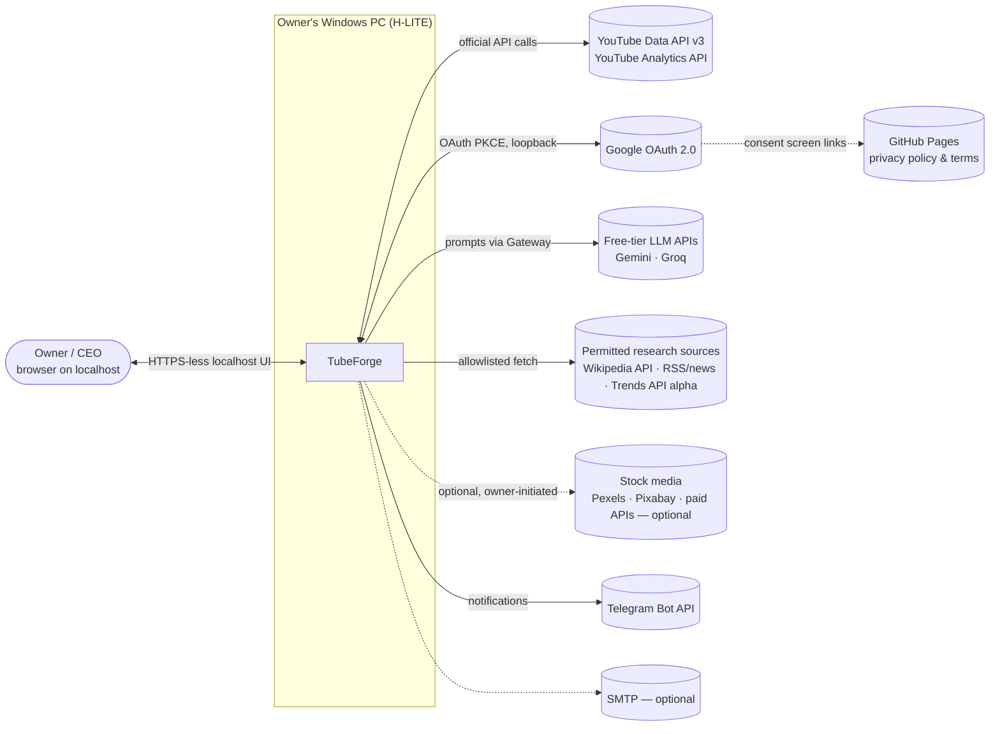
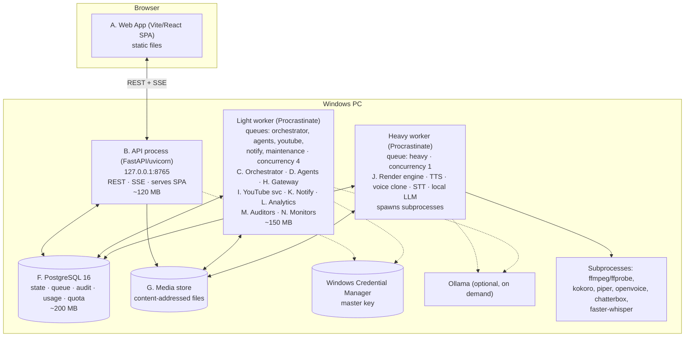
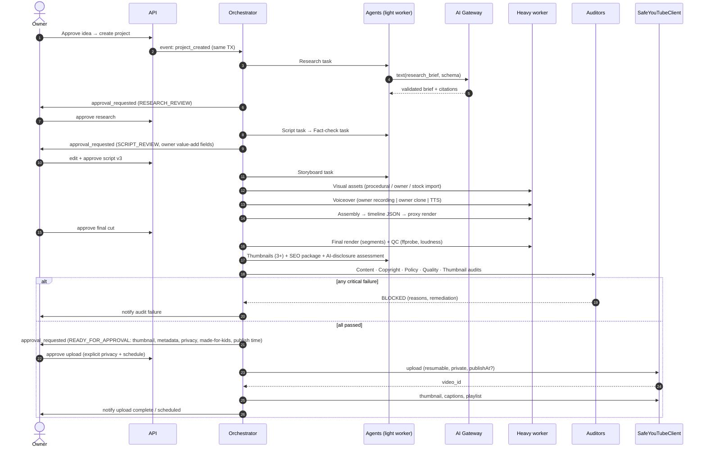
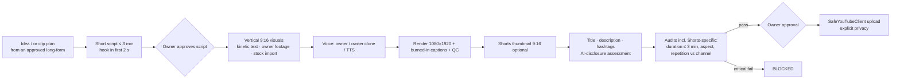
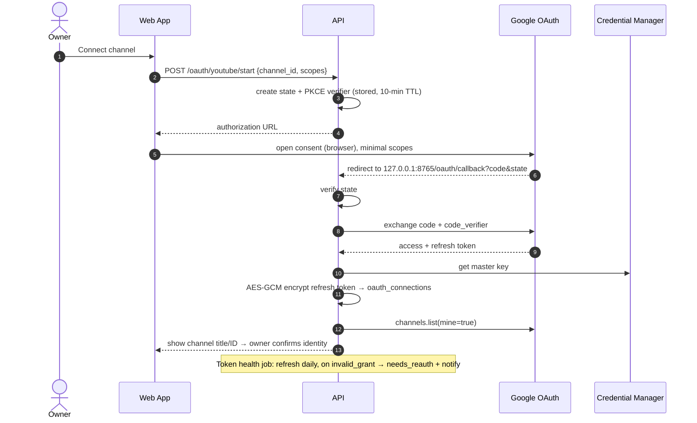
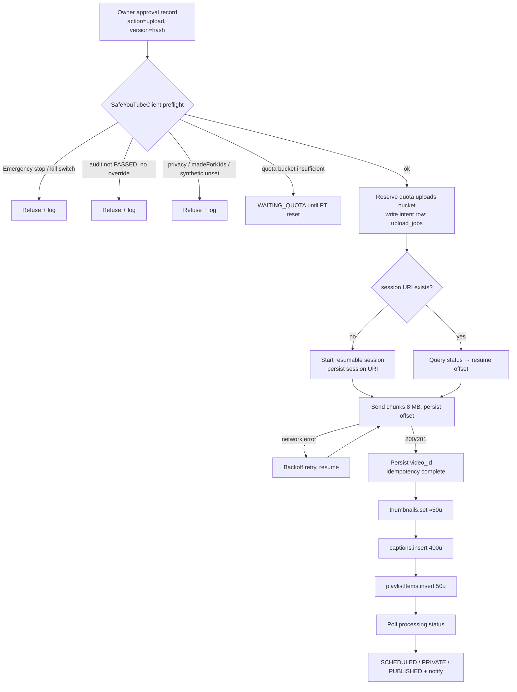
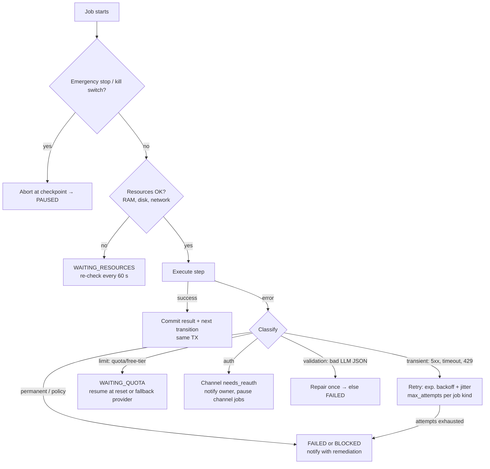

# System Architecture

**Version:** 1.0 (approved at C3, 2026-11-08) · **Date:** 2026-11-08
**Inputs:** PRD v1.2, TECH_STACK_EVALUATION, ADR-0001…0020, FREE_TIER_PROVIDER_MATRIX
**Target:** H-LITE (Windows 10, 8 GB RAM, no GPU). It scales up to H0–H2 through configuration only.

---

## 1. Architectural principles

1. **One machine, few processes.** Four resident processes at most. Heavy ML runs in short-lived subprocesses that free their RAM on exit.
2. **The database is the backbone.** State, queue, events, audit, usage and quota all live in PostgreSQL. Every state change and the job it triggers are committed in **one transaction**.
3. **Gates are in code paths, not in the UI.** Emergency Stop, kill switches, audit blocks, approvals, privacy, quotas and budgets are enforced inside the services that perform the action (defence in depth). The UI only displays them.
4. **Everything external goes through a gateway.** AI providers go through the **AI Provider Gateway**, YouTube through the **YouTube Integration Service**, stock sites through the **Stock Provider adapter**, and notifications through the **Notification Service**. No other module opens a connection to the outside world. CI enforces this with an import-lint rule.
5. **Untrusted content is data, never instructions.** Web, RSS, Wikipedia, comments and stock metadata are wrapped, sanitised and passed to LLMs only inside quoted data blocks, in tasks that have **no tool or action permissions**.
6. **Idempotent, resumable work.** Every job has an idempotency key. Every side effect records a durable "intent" before acting and a "result" afterwards.
7. **Replaceable adapters.** Interfaces for LLM, TTS, voice clone, STT, image generation, stock media, notifier and video engine.

---

## 2. Context diagram



**Trust boundaries:**
- **(B1)** Browser ↔ API: localhost only, session cookie + CSRF.
- **(B2)** TubeForge ↔ internet: outbound only, through gateways, with allowlists.
- **(B3)** Trusted code ↔ untrusted content: sanitisation and a no-tools rule.
- **(B4)** Agent roles ↔ privileged actions: agents can never publish, buy, delete, change privacy to public, or disable auditors.

---

## 3. Container diagram (runtime processes)



| Process | Starts | Resident RAM (est.) | Restart policy |
|---|---|---|---|
| PostgreSQL | Windows service, at boot | 150–250 MB | OS service |
| API | `tubeforge start` | ~120 MB | Supervisor in start script (restart on crash, max 5/10 min) |
| Light worker | `tubeforge start` | ~150 MB | Same |
| Heavy worker | `tubeforge start` | ~80 MB idle; jobs run in subprocesses (0.3–3 GB, one at a time) | Same |
| Ollama | Only if a local-LLM provider is enabled; idle unload after 5 min | 0 idle / 1.5–2.5 GB while loaded | On demand |

**RAM guard:** before a heavy job starts, the heavy worker checks available system RAM against the job's declared need (`ram_required_mb` in the job spec). If there isn't enough, the job waits (state `WAITING_RESOURCES`) and the dashboard shows why. Ollama is told to unload before a render or clone job.

---

## 4. Components (A–N)

Each component lists: **Purpose · Boundaries · Interfaces · Data owned · Failure modes · Scaling path · Tests.**

### A. Web App (frontend)
- **Purpose:** the owner's dashboard: 31 sections, global Emergency Stop, mode badges, quota meter, notifications.
- **Boundaries:** presentation only. No business rules beyond form validation. All decisions are made server-side.
- **Interfaces:** typed REST client generated from OpenAPI. An SSE stream at `/api/v1/events/stream` (job progress, notifications, state changes, kill-switch changes).
- **Data owned:** none (UI preferences such as theme or table layout go in local storage).
- **Failure modes:** API down → full-page "Backend offline" state with retry. SSE dropped → automatic reconnect with `Last-Event-ID` replay.
- **Scaling path:** none needed (single user). Later team roles via RBAC-aware routes.
- **Tests:** Vitest unit tests, Playwright E2E (all 31 routes × 4 states), axe accessibility checks.

### B. Backend API
- **Purpose:** authentication, RBAC, CRUD, commands (start, approve, override), file uploads, the SSE event stream, and serving the SPA.
- **Boundaries:** never calls external providers directly and never runs long tasks. It **enqueues commands** to the orchestrator inside the same DB transaction.
- **Interfaces:** REST `/api/v1/*` (problem+json errors, cursor pagination), SSE, `/healthz`, `/readyz`.
- **Data owned:** users, sessions, roles and permissions, audit log (writes), system settings.
- **Failure modes:** DB unavailable → 503 + readiness fails. Validation errors → 422 problem+json. Idempotency-key replay → returns the original result.
- **Scaling path:** stateless. More uvicorn workers if needed.
- **Tests:** contract tests (schemathesis-style against OpenAPI), authz matrix tests (role × endpoint), audit-row-on-every-write test.

### C. Master Orchestrator
- **Purpose:** owns every workflow state machine (`WORKFLOW_STATE_MACHINE.md`). Decides the next step, applies guards, creates approval requests, and enqueues agent tasks.
- **Boundaries:** contains **no LLM calls and no media processing**. It is pure deterministic logic over DB state.
- **Interfaces:** `transition(entity, event, actor, payload, idempotency_key)`. It consumes job-completion events and emits domain events (`state_changed`, `approval_requested`, `blocked`).
- **Data owned:** `workflow_transitions`, entity state columns, `approval_requests`.
- **Failure modes:** guard fails → transition rejected with a reason. Duplicate event → no-op (idempotency). Crash mid-transition → the DB transaction rolls back and the event is redelivered.
- **Scaling path:** row-level locks per entity allow parallel entities.
- **Tests:** table-driven tests that cover every transition, every guard, and illegal-transition rejection. Property tests (random event sequences never reach an invalid state).

### D. Agent services (32 logical agents)
- **Purpose:** do the work of each agent role (research, script, SEO, audits, …).
- **Boundaries:** an agent is a **task handler**: typed input in, schema-validated output out. Agents never call each other, never call providers directly (only the Gateway), and never call YouTube mutation methods. Production agents cannot write audit results.
- **Interfaces:** `AgentTask(input_schema) -> AgentResult(output_schema)`. Registered in the `agent_configurations` table (version, enabled, limits, prompt version).
- **Data owned:** `agent_runs` (input hash, output, tokens, duration, status, provider used).
- **Failure modes:** invalid LLM output → one repair attempt → fail with reason. Provider limit → task paused (`WAITING_QUOTA`). Kill switch → aborted at checkpoint.
- **Scaling path:** the same handlers run in more worker processes (H0+).
- **Tests:** golden tests with a mocked Gateway and fixed seeds, schema tests, adversarial prompt-injection tests on research inputs.

### E. Workflow & task queue
- **Purpose:** durable, retryable job execution.
- **Implementation:** Procrastinate on PostgreSQL behind the `JobQueue` interface (ADR-0004).
- **Queues:** `orchestrator` · `agents` · `youtube` (concurrency 1) · `notify` · `maintenance` (periodic: retention, token health, quota forecast, re-verify reminders) · `heavy` (concurrency 1).
- **Job spec fields:** `kind`, `entity_id`, `idempotency_key` (unique), `attempt`, `max_attempts`, `backoff`, `ram_required_mb`, `requires_network`, `checkpoint`.
- **Failure modes:** worker crash → lock released, job retried. Poison job → after `max_attempts` it moves to `FAILED` and the owner is notified.
- **Tests:** Linux + Windows CI smoke tests. Crash-recovery test (kill a worker mid-job → resumes once).

### F. Database (PostgreSQL)
- **Purpose:** the system of record (schema in `DATABASE_SCHEMA.md`, Step 0.5).
- **Conventions:** UUIDv7 keys, `created_at` / `updated_at`, soft delete where the PRD requires it, append-only audit log (DB role without UPDATE/DELETE on `audit_log`), partial unique indexes for idempotency (e.g. `UNIQUE(project_id, file_sha256) WHERE status <> 'FAILED'` on uploads).
- **Failure modes:** disk full → readiness fails and new jobs stop (Emergency-Stop-like). Corruption → restore from backup (Phase 15).
- **Tests:** Alembic up/down tests, constraint tests.

### G. Media storage
- **Purpose:** store every file (owner recordings, stock imports, generated audio, renders, thumbnails, captions).
- **Layout:** `%TUBEFORGE_DATA%\media\blobs\sha256\ab\cd\<hash>.<ext>` (content-addressed, deduplicated) plus a `media_assets` row (owner channel/project, kind, size, rights record, retention class). Working folders `%TUBEFORGE_DATA%\work\<job_id>\` are deleted when a job ends.
- **Retention classes:** `master` (kept until the owner deletes it) · `intermediate` (30 days after publish, then owner-confirmed cleanup) · `cache` (any time) · `sensitive` (voice samples/profiles, encrypted).
- **Failure modes:** checksum mismatch → asset quarantined. Disk ≥ 90 % → heavy jobs blocked, owner notified.
- **Tests:** checksum verification, retention-job tests, disk-threshold tests.

### H. AI Provider Gateway
- **Purpose:** the only path to LLM, TTS, voice-clone, STT and image providers.
- **Pipeline for every call:**
  1. Emergency Stop and provider kill-switch check
  2. Registry policy (tier allowed? commercial-use licence OK for this channel? data-use allowed for this channel's privacy class?)
  3. **Atomic usage reservation** against daily, monthly and per-task limits
  4. Cache lookup (hash of provider + model + prompt version + input)
  5. Call with timeout
  6. Output validation (JSON schema) and one repair attempt
  7. Usage settle (actual tokens, chars, seconds)
  8. Log (redacted) and return
- **Fallback chain:** per task type, from config (e.g. `script_draft: [gemini-flash, groq-gpt-oss, ollama-small]`). It moves on when a limit is reached, the provider fails, or policy blocks it.
- **Interfaces:** `text(task, messages, schema)`, `tts(text, voice)`, `voice_convert(audio, profile)`, `stt(audio, lang)`, `image(prompt, spec)`.
- **Data owned:** `provider_registry`, `usage_records`, `gateway_cache`.
- **Failure modes:** every provider in the chain exhausted → task `WAITING_QUOTA` with resume time. Licence mismatch → hard error, logged.
- **Tests:** "provider pauses at limit" test (required by the PRD), licence-block test, data-use-block test for local-only channels, cache-hit test, schema-repair test.
- **Implementation (Phase 5, `apps/api/tubeforge/gateway/`):**
  - Adapters for Gemini (key sent in the `x-goog-api-key` header, never in the URL), Groq and Ollama (loopback only), over httpx (ADR-0026).
  - The gateway commits its own usage rows, so every worker sees a reservation before the slow call.
  - A local-only channel may use only Tier L providers or providers with `data_use_training = false`. "Unknown" counts as "may train".
  - Billing or payment wording in any provider response triggers A32 (provider kill switch + CRITICAL alert).

### I. YouTube Integration Service
- **Purpose:** OAuth, channel verification, uploads, metadata, thumbnails, captions, playlists, analytics retrieval, the quota ledger, and retention and deletion jobs.
- **`SafeYouTubeClient`:** the only class allowed to call YouTube mutation methods. Before **every** mutating call it checks:
  - Emergency Stop off
  - Publishing kill switch off (for public or scheduled actions)
  - Channel `connected` and token healthy
  - Project audit status `PASSED` or owner override
  - An approval record exists for this exact action and version
  - `privacyStatus`, `selfDeclaredMadeForKids` and `containsSyntheticMedia` all **explicitly set**
  - Private-only mode respected
  - Quota reservation succeeds in the correct bucket
  - Idempotency key not already completed
- **Resumable upload:** session URI persisted in `upload_jobs`. After a crash, query the upload status and resume from the confirmed byte offset.
- **Library:** `google-api-python-client` + `google-auth-oauthlib` (Apache-2.0). Installed-app flow, loopback redirect, PKCE.
- **Data owned:** `oauth_connections` (encrypted tokens), `quota_ledger`, `upload_jobs`, `youtube_api_cache` (non-authorized data with `expires_at` ≤ 30 days), `analytics_snapshots`.
- **Failure modes (classified):** `AUTH_EXPIRED` (→ channel needs_reauth) · `QUOTA_EXCEEDED` (→ wait for PT reset) · `RATE_LIMITED` (→ backoff) · `TRANSIENT_5XX` (→ retry) · `INVALID_REQUEST` (→ fail, owner fix) · `POLICY_REJECTED` (→ blocked, owner).
- **Tests:** mocked-API unit tests, a test proving the invariants (insert without privacy is rejected, blocked project is rejected), and a manual real private upload to the test channel.

### J. Render engine
- **Purpose:** compile timeline JSON into FFmpeg filter graphs; produce proxy renders and final renders; run QC with ffprobe and loudness measurement.
- **Boundaries:** pure function of (timeline, assets) → file. Assets must have a valid rights record (the compiler refuses otherwise).
- **Failure modes:** FFmpeg error → captured stderr in the job log, classified. Out of memory → retried with a lower-memory preset. Crash → restart from the last completed segment (long-form is rendered in segments and then concatenated).
- **Scaling path:** NVENC/QSV on H1+, parallel segments on H0+.
- **Tests:** ffprobe assertions (duration ±0.1 s, streams, resolution, fps), loudness within ±1 LU of target, black/freeze/silence detection fixtures, determinism test.

### K. Notification Service
- **Purpose:** turn domain events into notifications (in-app, Telegram, email) with preferences, quiet hours (Asia/Karachi), dedup and digests.
- **Interfaces:** `notify(event_type, severity, entity, dedup_key, payload)`.
- **Data owned:** `notifications`, `notification_deliveries`, `notification_preferences`.
- **Failure modes:** Telegram 429 → backoff respecting `retry_after`. Channel misconfigured → falls back to in-app only.
- **Tests:** dedup window, quiet-hours bypass for critical events, retry tests.

### L. Analytics Service
- **Purpose:** daily snapshots of the owner's channel and video metrics (Analytics API). Feeds the Growth agent.
- **Compliance:** own-channel data only. Authorization and video existence are re-checked every 30 days. Deleted within 7 days on disconnect.
- **Tests:** mocked Analytics responses, retention and re-verification jobs.

### M. Copyright & Policy Auditing Service
- **Purpose:** run the independent audits (content, copyright, policy, quality, thumbnail) and produce reports with result, score, reason, evidence and remediation.
- **Independence:** separate agent roles. Results are written only by auditor roles. Production agents have no write permission to `audit_reports`. An override is written **only** by the owner with a reason.
- **Blocking:** any critical failure moves the project to `BLOCKED`. The `SafeYouTubeClient` re-checks the audit status independently.
- **Tests:** "blocked video cannot upload" through every API path. Override requires a reason.

### N. Security & Operational Monitoring
- **Purpose:** security events (failed logins, permission violations, kill-switch use), system health (disk, RAM, queue depth, failed jobs), cost and usage monitor, token health, re-verification reminders, inactivity warning (YouTube 90-day rule), backup status.
- **Data owned:** `security_events`, `system_health_samples`.
- **Tests:** alert threshold tests, log-redaction tests (no tokens or keys in logs).

### O. Stock Media & Voice modules (added at C2)
- **Stock (ADR-0020):** `StockProvider` interface (manual import, Pexels, Pixabay, paid slots). Purchases go through a **Purchase Gate**: owner confirmation per item, price shown, monthly budget cap (default 0). Outbound calls only through this adapter.
- **Voice (ADR-0019):** `VoiceProfileService` (live recording, consent with one-time code, speaker-match check, encrypted profile) and `VoiceCloneAdapter` (OpenVoice converter, Chatterbox zero-shot) behind the Gateway's `voice_convert` / `tts` interfaces. Profiles never leave the PC.

---

## 5. Cross-cutting controls

| Control | Where enforced (all of them, not either/or) |
|---|---|
| **Emergency Stop** | `system_settings.emergency_stop` → (1) orchestrator refuses transitions except to PAUSED/CANCELLED; (2) every job checks at start and at each checkpoint; (3) running jobs get an abort via Procrastinate cancellation + `LISTEN/NOTIFY`; (4) Gateway refuses calls; (5) `SafeYouTubeClient` refuses mutations. Target: everything stopped within 30 s. |
| Per-channel / per-agent / per-provider / publishing kill switches | Same layers, scoped |
| Explicit privacy | `SafeYouTubeClient` invariant + unit test + contract test |
| Approval gates | Orchestrator guards + `SafeYouTubeClient` approval-record check |
| Free-tier limits | Gateway reservation + Stock Purchase Gate + quota ledger |
| Rights records | Render compiler refuses assets without rights |
| Untrusted content | Sanitiser + "data block" prompt wrapper + no-tools rule for those tasks |
| Audit log | API middleware (every write) + orchestrator (every transition) + gateways (every external call) |

---

## 6. Data flow — one long-form video



## 7. Data flow — one Short



Shorts cut from the owner's own long-form video are allowed. Cutting third-party videos is never allowed. The repetition auditor compares each Short against the channel's other Shorts (template-look risk, F3).

---

## 8. OAuth flow (installed app, loopback + PKCE)



**Scopes** (minimum per enabled feature, finalised in OAUTH_SECURITY.md):
- `youtube.upload` for uploads.
- `youtube.force-ssl` only when captions, comment moderation or metadata updates are enabled.
- `yt-analytics.readonly` for analytics.
- No monetary scope (D-8).

## 9. Upload flow



Each post-upload step is its own idempotent job, so a failed thumbnail never causes a re-upload.

## 10. Failure & retry flow



Defaults: `max_attempts` = 5 (network), 3 (agent LLM), 2 (render). Backoff = 2^n × 5 s, capped at 15 min, ±20 % jitter.

---

## 11. Deployment view (H-LITE)

**Install location (owner decision at C3):** everything TubeForge owns lives on drive **D:**, under `D:\YOUTUBE AUTOMATION SYSTEM SOFTWARE`.

```
D:\YOUTUBE AUTOMATION SYSTEM SOFTWARE\          = %TUBEFORGE_HOME%
├── app\              program: Python venv, built dashboard (SPA), scripts
├── tools\            ffmpeg.exe, ffprobe.exe (pinned build)
├── models\           TTS / voice-clone / STT / local-LLM model files (hash-pinned)
├── data\             = %TUBEFORGE_DATA%
│   ├── media\blobs\  content-addressed media store
│   ├── work\         per-job temp folders (auto-cleaned)
│   ├── backups\      DB + encrypted-secrets backups (owner may also copy to an external drive)
│   └── logs\         JSON logs (rotated, redacted)
├── pgdata\           PostgreSQL data directory (cluster created by the installer here, not on C:)
├── config\           tubeforge.toml (non-secret settings only)
├── TubeForge.lnk     desktop-shortcut target: starts services and opens http://127.0.0.1:8765
└── tubeforge.ps1     start | stop | status | backup | restore | doctor | update
```

- PostgreSQL 16 runs as a Windows service. Its data directory is `pgdata\` on D:, bound to localhost:5432, database `tubeforge`.
- Ollama (optional) is pointed at `models\ollama\` through the `OLLAMA_MODELS` env var, so models don't fill C:.
- Python and uv caches are redirected to `D:\…\app\.cache`.
- **Path has spaces:** every script quotes paths, FFmpeg arguments are passed as argv lists (never shell strings), and the **Windows CI job installs into a path containing spaces** (`C:\Tube Forge Test\`) to catch quoting bugs.
- `doctor` checks free space **on D:** (≥ 60 GB). C: needs only room for the PostgreSQL program files (~300 MB).

`doctor` checks:
- disk ≥ 60 GB free
- RAM
- Windows build and ESU status hint
- FFmpeg version
- DB connection
- keyring access
- time sync (needed for OAuth and TOTP)

## 12. Security architecture summary
Full detail in `OAUTH_SECURITY.md` (Step 0.5).
- Localhost bind.
- Argon2id + optional TOTP.
- Server-side sessions.
- CSRF protection.
- AES-GCM envelope encryption with the master key in Credential Manager.
- Encrypted voice profiles.
- Redacted logs.
- gitleaks and dependency audits.
- An outbound host allowlist per adapter.
- Safetensors/ONNX-only model loading with pinned hashes.

## 13. Decisions at C3

| ID | Question | Proposal |
|---|---|---|
| A-1 | Run TubeForge automatically at Windows login? | ✅ Decided at C3: No. The owner starts it from the desktop shortcut. Optional later. |
| A-2 | Night render window | ✅ Decided at C3: 01:00–07:00 Asia/Karachi, default ON for final long-form renders. Proxies any time. |
| A-3 | Dashboard address | ✅ Decided at C3: `http://127.0.0.1:8765` (configurable). |
| A-4 | Install location | ✅ Decided at C3 (owner): `D:\YOUTUBE AUTOMATION SYSTEM SOFTWARE` — program, data, models, DB data and backups all on D:. |
