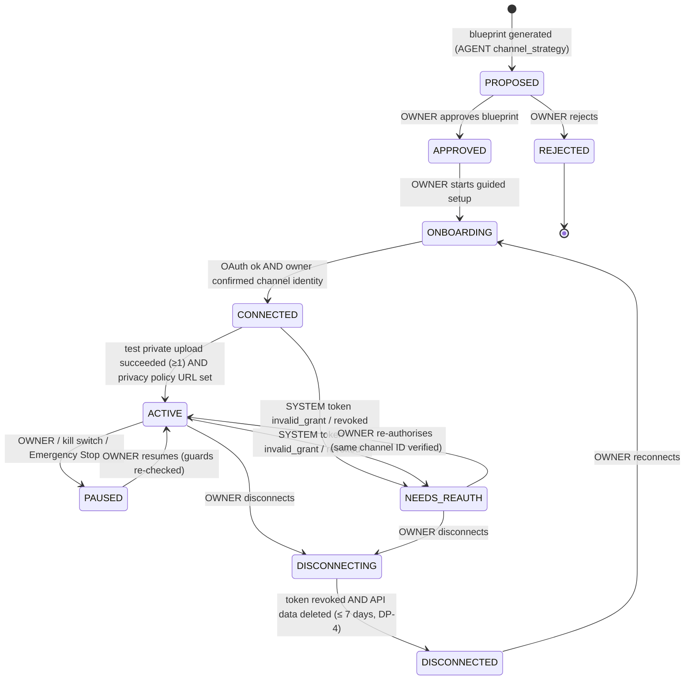
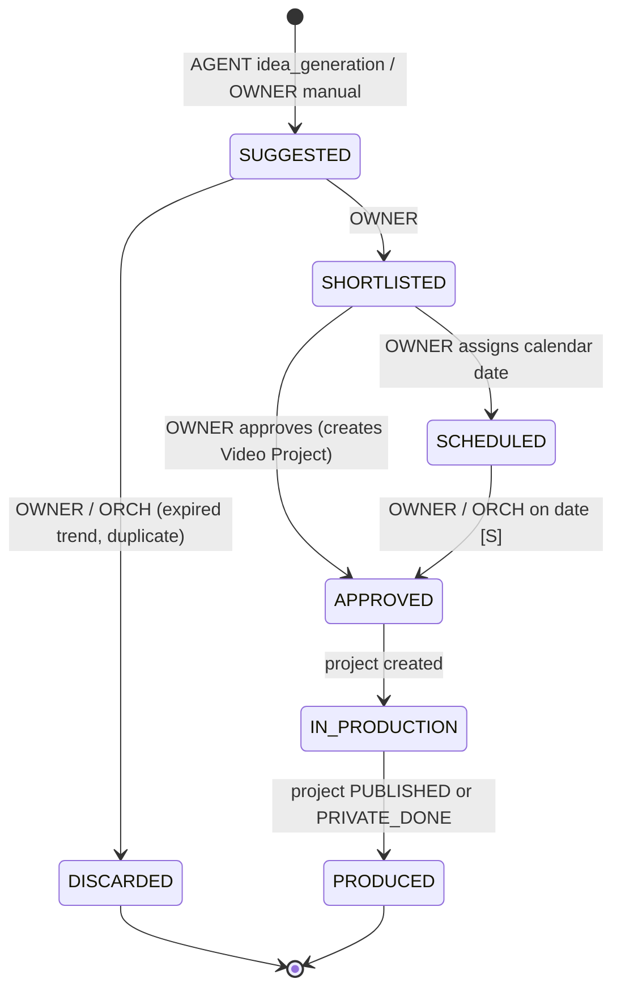
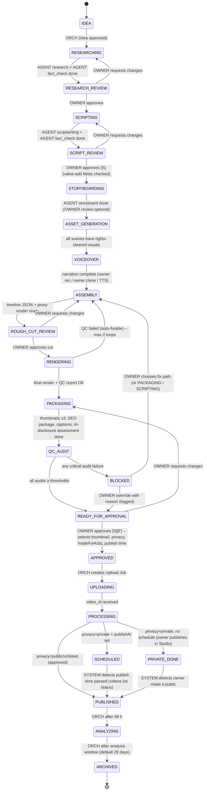
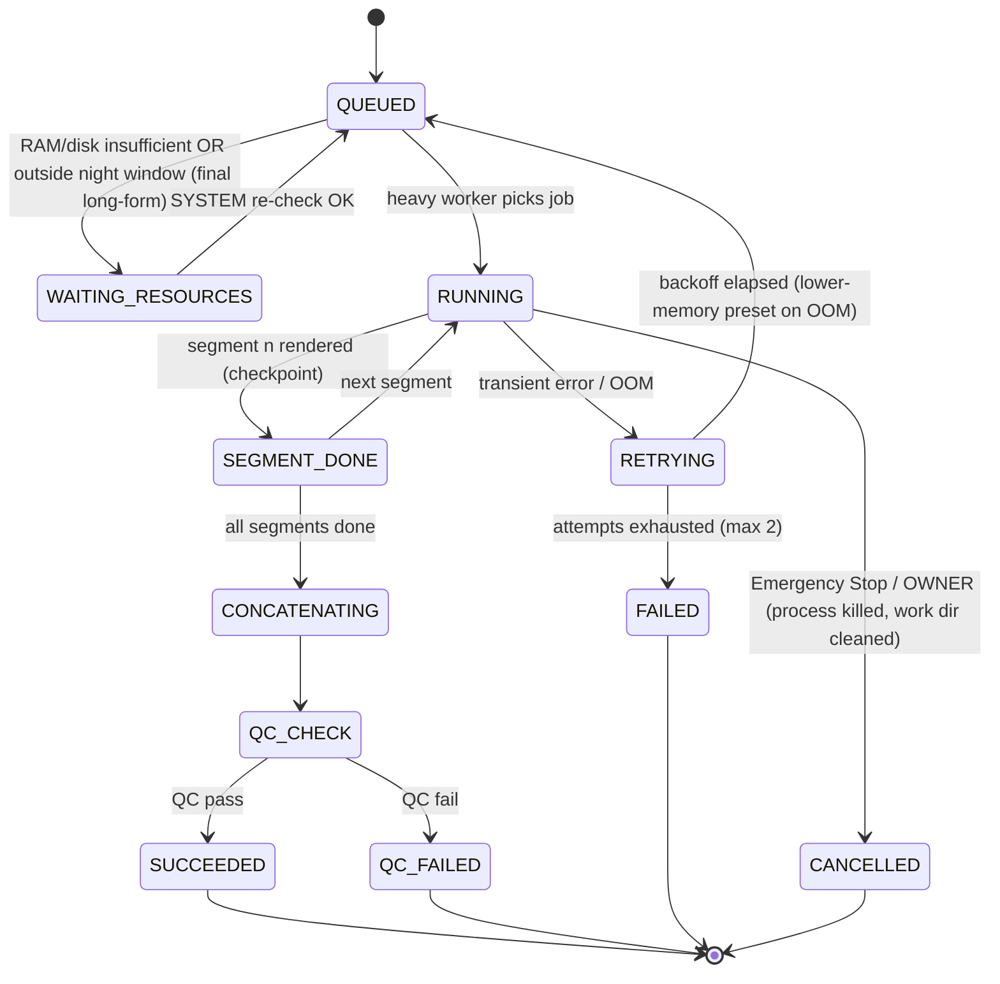
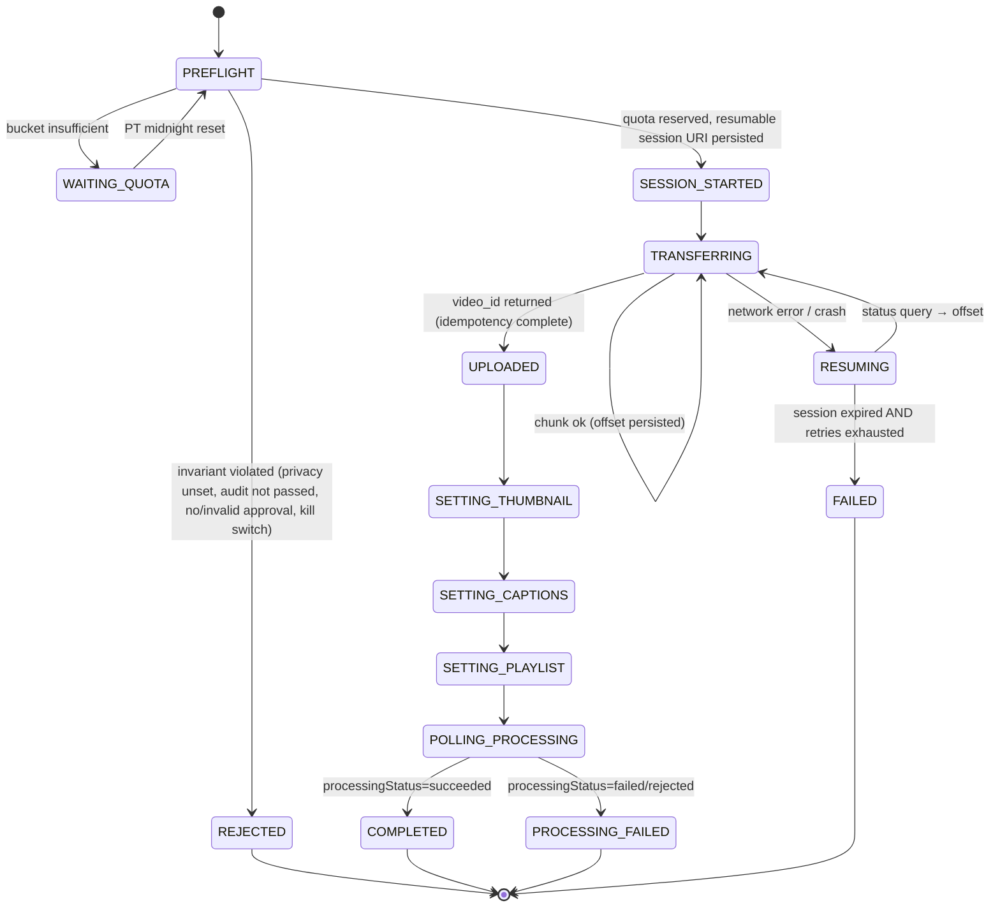
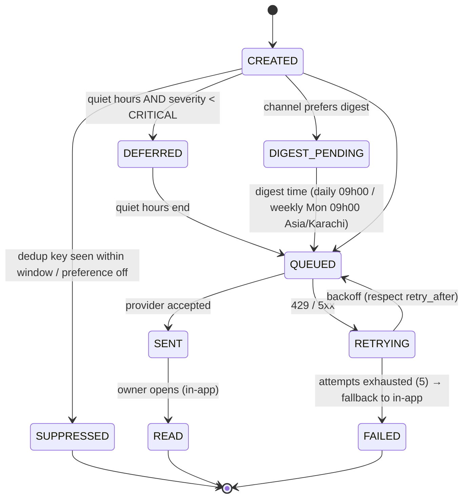
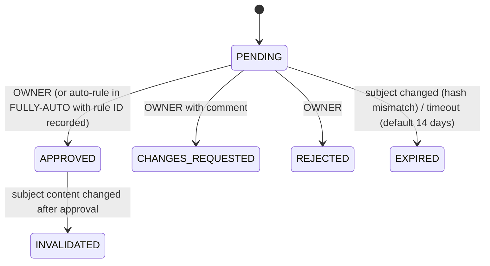
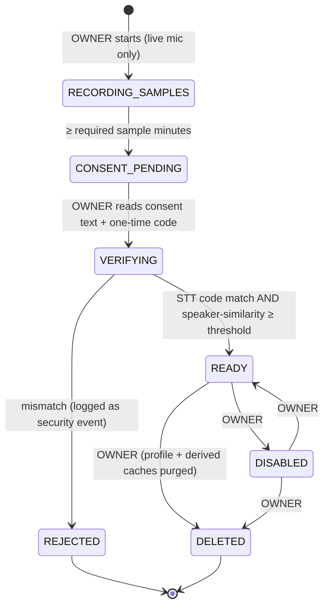

# Workflow State Machines

**Version:** 0.1 (Step 0.4, for Checkpoint C3) · **Date:** 2026-11-08
**Owner of all transitions:** Master Orchestrator (`SYSTEM_ARCHITECTURE.md` §4-C).

## 0. Rules that apply to every state machine

1. **Persisted and atomic.** A transition is one DB transaction:
   - lock the entity row (`SELECT … FOR UPDATE`)
   - check the guard
   - write the new state
   - insert a `workflow_transitions` row (entity, from, to, event, actor, reason, idempotency key, timestamp)
   - insert an `audit_log` row
   - enqueue the next job(s)
2. **Idempotent.** `(entity_id, idempotency_key)` is unique in `workflow_transitions`. Replaying an event is a no-op that returns the existing result.
3. **Resumable.** On restart the orchestrator scans for entities whose state expects a job and has no live job, and re-enqueues them (a "reconciler" periodic job, every 2 min).
4. **Actors.**
   - `OWNER` — human, via the API.
   - `ORCH` — the orchestrator's automatic rules.
   - `AGENT:<id>` — task completion.
   - `AUDITOR:<id>` — an independent audit.
   - `SYSTEM` — monitors such as token health, quota or emergency stop.
5. **Universal states** (any non-terminal state can move to them):
   - `PAUSED` — by Emergency Stop, a kill switch or the owner. It stores `resume_to` = the previous state. Resuming needs an OWNER action. A SYSTEM resume is allowed only for quota and resource waits.
   - `CANCELLED` — OWNER only. Terminal.
   - `FAILED` — SYSTEM/AGENT after retries are exhausted. OWNER may retry, which moves the entity back to the last stable state.
6. **Mode-dependent approvals.** "Owner approval" gates below apply in MANUAL mode. In SEMI-AUTOMATIC mode only the gates marked **[S]** remain. In FULLY-AUTOMATIC mode only gates marked **[F]** remain; the others are satisfied by an **auto-approval record** produced by the owner-accepted rule set, if the rule conditions hold (audit scores ≥ thresholds, topic allowed, caps not exceeded, not in quiet hours).
7. **Emergency Stop** blocks every transition except → `PAUSED` / `CANCELLED`.

---

## 1. Channel

| Transition | Guard | Side effects |
|---|---|---|
| ONBOARDING → CONNECTED | `channels.list(mine)` ID == ID the owner confirmed. Scopes granted ⊇ required. | Store encrypted token. Set `private_only_mode = ON`. |
| CONNECTED → ACTIVE | ≥ 1 successful private test upload (`is_test`) on a test channel **or** on this channel. Privacy-policy URL configured. | Enable job scheduling for the channel. |
| any → NEEDS_REAUTH | Token refresh fails with `invalid_grant` or 401. | Pause the channel's YouTube jobs. Critical notification. |
| DISCONNECTING → DISCONNECTED | Revoke call done (or token already invalid). Retention job purged YouTube API data for the channel. | Deletion deadline monitor closed. |
| `private_only_mode` OFF | OWNER only. ≥ 3 successful private test uploads. | Audit log + security event. |

## 2. Idea

Guards:
- **→ APPROVED:** similarity to existing channel ideas and videos < threshold (default 0.85), or OWNER override with reason. Topic not on the channel's blocked list.
- **ORCH discard:** a trend-based idea past `expires_at`, unless shortlisted.

## 3. Video Project (long-form and Short share this machine; `format` = LONG | SHORT)

Universal: any non-terminal state → `PAUSED` | `CANCELLED` | `FAILED`.

### Guard table (Video Project)

| Transition | Guard (all must hold) | Responsible |
|---|---|---|
| RESEARCH_REVIEW → SCRIPTING | Research brief valid. Every claim has ≥ 1 source. No `contradicted` claim without owner override. | OWNER |
| SCRIPT_REVIEW → STORYBOARDING | Script version locked. Fact-check: 0 `contradicted` (or override). **Owner value-add** record exists (≥ 1 field filled; configurable minimum). Estimated duration fits the format (SHORT ≤ 180 s). | OWNER [S] |
| ASSET_GENERATION → VOICEOVER | Every scene has ≥ 1 visual asset with a valid **rights record**. No asset with an editorial-only or non-commercial licence on a monetised channel. Stock purchases (if any) confirmed individually by the owner within budget. | ORCH |
| VOICEOVER → ASSEMBLY | Every scene has narration audio. If `voice_source = owner_clone`, a valid consent record exists for the voice profile. TTS voices have commercial-OK licences. | ORCH |
| ROUGH_CUT_REVIEW → RENDERING | Owner approved the specific timeline version hash. | OWNER |
| RENDERING → PACKAGING | QC: duration matches the timeline (±0.1 s), required streams present, resolution and fps as configured, integrated loudness within ±1 LU of target, no black or frozen segment > 2 s (unless intended), no silence gap > 3 s (unless intended). | ORCH |
| PACKAGING → QC_AUDIT | ≥ 3 thumbnails pass technical checks. SEO: title ≤ 100 chars, chapters validated against the final duration. Captions synced. `containsSyntheticMedia` decision + reason present. | ORCH |
| QC_AUDIT → READY_FOR_APPROVAL | All audit reports PASSED (content, copyright, policy, quality, thumbnail). Originality score ≥ threshold. Channel publishing caps would not be exceeded. | AUDITORS |
| BLOCKED → READY_FOR_APPROVAL | OWNER override with a written reason (≥ 20 chars). **Not available** for copyright-critical failures (missing rights record) — those must be fixed. | OWNER |
| READY_FOR_APPROVAL → APPROVED | Owner selected: thumbnail, final title, `privacyStatus` (explicit), `selfDeclaredMadeForKids` (explicit), `containsSyntheticMedia` (confirmed), publish time (optional). If Private-only mode is ON, privacy must be `private` and no `publishAt`. Approval record stores a hash of the exact metadata + render + thumbnail. | OWNER [S][F] |
| APPROVED → UPLOADING | Approval hash == current package hash (any change after approval invalidates it). Channel ACTIVE. Publishing kill switch OFF (for public or scheduled). | ORCH |

### What "auto-fixable" means (RENDERING → ASSEMBLY)
Loudness out of range (re-normalise), a small A/V drift (re-mux), or a missing caption track. After two loops the project goes to `FAILED` and the owner is notified.

## 4. Render Job

Resume after a crash restarts from the last `SEGMENT_DONE` checkpoint. Proxy renders use the same machine with `kind = PROXY` (single segment, no night window).

## 5. Upload Job

Notes:
- The DB enforces **one non-failed upload per (project_id, file_sha256)**. A second attempt reuses the existing job.
- If a session expired and the resumable upload cannot continue, a new session is created **only** after confirming via `videos.list` (owner's uploads, matching the title and the stored `upload_marker` in the description) that the first attempt did not finish. This prevents duplicates.
- Each `SETTING_*` step is retried on its own. On permanent failure the job completes with a warning and the owner is notified (for example, thumbnail rejected → set manually in Studio).

## 6. Notification

Each delivery channel (in-app, Telegram, email) has its own delivery row with this state machine. In-app delivery is always created.

## 7. Approval Request (used by every OWNER gate)

The approval record stores: subject type and ID, **subject content hash**, actor, mode, rule ID (if auto), comment and timestamp. Downstream guards compare the hash.

## 8. Voice Profile (ADR-0019)

## 9. Stock Purchase (ADR-0020, paid providers only)

```mermaid
stateDiagram-v2
    [*] --> QUOTED : OWNER selects asset; adapter returns price + licence
    QUOTED --> REFUSED : budget cap exceeded / provider disabled / editorial-only on monetised channel
    QUOTED --> CONFIRMED : OWNER confirms THIS purchase (price shown)
    CONFIRMED --> LICENSED : provider confirms licence
    LICENSED --> DOWNLOADED : file stored + rights record (licence proof) written
    CONFIRMED --> FAILED : provider error (no charge recorded)
    REFUSED --> [*]
    DOWNLOADED --> [*]
    FAILED --> [*]
```

Agents can never create a `CONFIRMED` transition. Only the `OWNER` actor is allowed, and this is enforced in the orchestrator **and** in the Stock adapter.

---

## 10. Test requirements for this document (Phase 5)
- Table-driven test per machine: every allowed transition succeeds with its guard satisfied, and fails with each guard violated individually.
- Every unlisted (from, event) pair is rejected.
- Emergency Stop: every transition except → PAUSED/CANCELLED is rejected.
- Idempotency: the same event twice → one transition row.
- Crash simulation: kill the worker between the state write and the job enqueue — impossible by design (same TX). Kill it during a job → the reconciler re-enqueues it exactly once.
- Approval hash invalidation: edit metadata after approval → APPROVED → UPLOADING is rejected.
